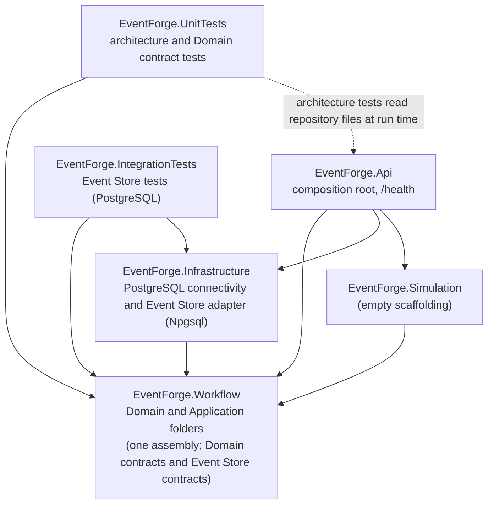
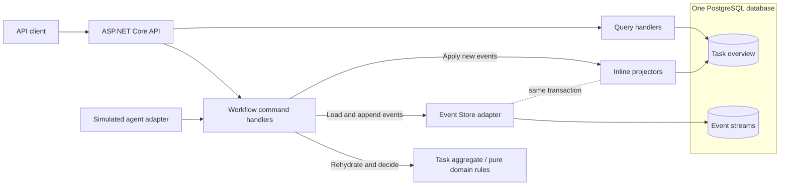
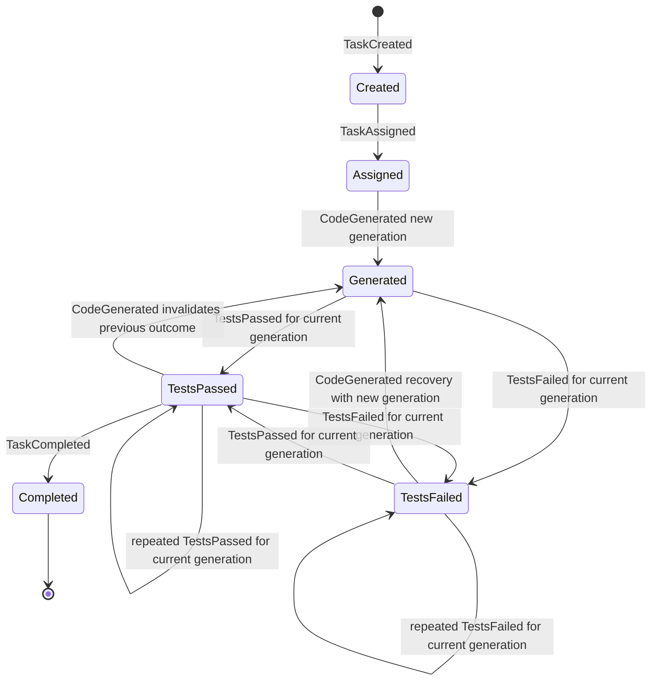
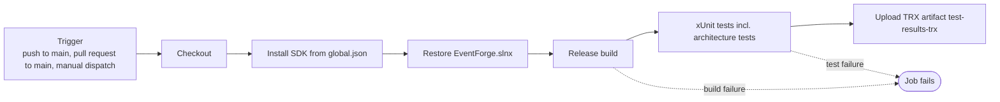

# EventForge

[](https://github.com/FarazLoloei/eventforge-event-sourcing-demo/actions/workflows/ci.yml)


**Building a deterministic, auditable, event-driven foundation for AI-assisted software engineering workflows.**

EventForge is an independent portfolio project exploring how **Event Sourcing, CQRS, Domain-Driven Design (DDD) and a Modular Monolith** can provide a reliable foundation for an AI-assisted software development workflow. The planned implementation uses **C# / .NET 10 and PostgreSQL**. AI agents will be **simulated**: the goal is to demonstrate the correctness of the workflow engine, not to integrate an LLM service.

> **Current status: Active development — engineering foundation, Event Store, pure Task aggregate and command handler implemented; API, projections and replay planned.**
> The repository contains a verified .NET 10 solution, a minimal ASP.NET Core host, Clean Architecture project scaffolding, validated dependency injection, automated architecture dependency tests, a working GitHub Actions baseline CI pipeline and (EVF-21) PostgreSQL connectivity code, native launch configuration, optional Docker files and provisioning SQL. **EventForge is not yet a working workflow engine:** the pure Task aggregate (EVF-28/EVF-29) and the Application command handler that persists its events through the Event Store (EVF-30) exist and are tested locally, but no workflow endpoints, composition-root registration, projections or replay exist. The PostgreSQL event store (EVF-22: append/load with expected-version concurrency, migration and PostgreSQL 17 integration tests) is **implemented and verified in CI** ([PR #16](https://github.com/FarazLoloei/eventforge-event-sourcing-demo/pull/16)); it is used by the EVF-30 Application command handler but not by any API or projection. Per the [verification status](#development-environment-evf-21), the owner's existing PostgreSQL passed an owner-run check, Visual Studio was owner-reported healthy and VS Code launch is not independently verified. Everything under [Why EventForge?](#why-eventforge), [Architecture](#architecture) (planned runtime and lifecycle) and [Roadmap](#roadmap) describes intended design, not delivered functionality.

## Engineering highlights

- **Verified baseline:** .NET 10 SDK pinned by `global.json`; Release build with 0 warnings and 0 errors; 33 passing tests confirmed in GitHub Actions at the EVF-5 baseline (see [Continuous integration](#continuous-integration)) and, after EVF-21, a verified `main` CI run with 42 passing tests, 0 failures, 0 skipped and 0 build warnings or errors. The later EVF-22 CI results are recorded in the Event Store row below. For EVF-23 (Task 4: EVF-28 to EVF-31) the evidence is **local only**, not GitHub CI: Release build with 0 warnings and 0 errors; 235 unit/architecture tests passed; 21 non-database and 31 PostgreSQL integration tests passed (52 in total, 0 failed, 0 skipped) against a disposable PostgreSQL 17 container. Consolidated pull-request CI is pending.
- **Architecture enforced by tests:** project references and namespace dependencies are checked from the real `.csproj` files and Roslyn semantic analysis, including fixtures that prove forbidden dependencies are rejected.
- **Clean Architecture from the first commit:** Workflow owns the domain; HTTP, persistence and simulation are adapters that depend inward.
- **Fail-closed validation:** built-in DI with `ValidateOnBuild` and `ValidateScopes`; static analysis reports `analysis-incomplete` rather than silently passing.
- **Documented governance:** Jira-linked delivery, human-controlled Git and pull requests, explicit architectural approval and AI-agent rules (see [AI-assisted engineering and governance](#ai-assisted-engineering-and-governance)).
- **Honest status reporting:** every capability is labelled implemented or planned; nothing is claimed without verification.

## Current implementation

### Implemented and verified

| Area | Status |
| --- | --- |
| .NET 10 solution (`EventForge.slnx`) and SDK pin (`global.json`) | Implemented |
| Minimal ASP.NET Core host (`src/EventForge.Api`) | Implemented |
| `/health` endpoint (process liveness only; no database or dependency checks) | Implemented |
| Clean Architecture project scaffolding (`Workflow`, `Infrastructure`, `Simulation`) with the project references below | Implemented (`Simulation` is empty; `Workflow` and `Infrastructure` contain only the types listed in this table) |
| Task domain contracts (EVF-28): strongly typed identifiers (`TaskId`, `AgentId`, `GenerationId`, `ArtifactRef`), initial `TaskState`, six commands, the six approved event definitions with `TaskEventContract` (stream type `Task`, schema version 1), and `Decision`/`RejectionCode` result types in `EventForge.Workflow.Domain`; focused contract tests in `tests/EventForge.UnitTests/Domain` | Implemented (contracts) |
| Task aggregate logic (EVF-29): pure, deterministic `TaskAggregate.Decide`, `Apply` and `Rehydrate` in `EventForge.Workflow.Domain` with explicit `Rejected(RejectionCode)` results, `InvalidEventHistoryException` for invalid or malformed history, and unit tests in `tests/EventForge.UnitTests/Domain` | Implemented; verified locally only (Release build, unit/architecture tests; pull-request CI has not run). Used by the EVF-30 command handler (next row); not exposed through any API, projections or replay |
| Task command workflow (EVF-30): `TaskCommandHandler`, `TaskCommandResult` types and the explicit schema v1 `TaskEventMapper` in `EventForge.Workflow.Application.Tasks`; handler unit tests (in-memory test double) and PostgreSQL integration tests (`TaskWorkflowPostgresTests`) | Implemented. Loads the `Task` stream, checks the caller's expected version, rebuilds the aggregate, calls `Decide` and appends the resulting events through `IEventStore.AppendAsync` (one PostgreSQL transaction). Domain rejections append nothing; version conflicts, duplicate event ids, invalid history and unknown commit outcomes are returned as explicit results and never retried. Reads are strict (unknown event types, other schema versions, missing or extra payload properties are rejected). Not request idempotency. Verified locally: Release build, unit/architecture tests and PostgreSQL integration tests against a disposable PostgreSQL 17 (author-reported local run); pull-request CI has not run. Not exposed through any API or registered in the composition root; no projections, replay or upcasting |
| Native DI with `ValidateOnBuild` and `ValidateScopes` (EVF-17) | Implemented; only health checks are explicitly registered |
| xUnit project with Roslyn-based architecture dependency tests (EVF-16) | Implemented; limited to the checks in [Automated architecture validation](#automated-architecture-validation) |
| GitHub Actions baseline CI with TRX test-result artifacts (EVF-5) | Implemented and verified, including controlled failure and recovery; see [Continuous integration](#continuous-integration) |
| Npgsql 10.0.3 connectivity in Infrastructure: `PostgreSqlDatabase` owns one `NpgsqlDataSource` (singleton, disposed by the container, created lazily) and a read-only `--verify-database` check (EVF-21) | Implemented; verified locally against an isolated Compose PostgreSQL 17.12 (authentication, `--verify-database` natively and in the Compose network); owner-run check against the owner's existing PostgreSQL 17.11 (`127.0.0.1:5434`) **passed** |
| Launch profiles, VS Code configuration, user-secrets support (EVF-21) | Implemented; credential-free; `dotnet run` exercised by the author; Visual Studio launch and `/health` owner-reported healthy; VS Code launch **not independently verified** |
| `Dockerfile`, `.dockerignore`, `compose.yaml`, `.env.example` (EVF-21) | Implemented; image built, stack started, `/health` 200 and `docker compose down` verified locally (not CI) |
| `db/provisioning/001-provision.sql` role/database/schema provisioning (EVF-21) | Implemented; executed once on a fresh isolated Compose volume (roles, database, schema and privileges checked); never run against any existing server |
| Architecture checker resolves the approved Npgsql package (EVF-21) | Implemented and verified by tests; see [Automated architecture validation](#automated-architecture-validation) |
| Event Store (EVF-22): Application contracts `IEventStore`, `StreamKey`, `NewEvent`, `StoredEvent`, `LoadedStream`, `AppendResult`; `PostgreSqlEventStore` in Infrastructure; migration `db/migrations/001-create-event-store.sql`; `tests/EventForge.IntegrationTests`; CI job `postgres-integration` | Implemented and verified: merged in [PR #16](https://github.com/FarazLoloei/eventforge-event-sourcing-demo/pull/16); PR CI ([run 44706915605](https://github.com/FarazLoloei/eventforge-event-sourcing-demo/actions/runs/44706915605)) and post-merge `main` CI ([run 44707030609](https://github.com/FarazLoloei/eventforge-event-sourcing-demo/actions/runs/44707030609)) passed: 42 unit/architecture tests and 21 non-database tests, plus 15 PostgreSQL 17 integration tests (migration first run and re-run, append/load, conflicts, concurrency, rollback, privileges) against an isolated disposable PostgreSQL, with zero failures and zero skips. The migration has **not** been executed against the owner's development database (`127.0.0.1:5434`). At delivery it was not used by any workflow; the EVF-30 Application command handler now uses it, although no API or projections are connected. The Event Store was delivered without Task domain events or an aggregate; EVF-28 and EVF-29 have since added them in the Domain, and EVF-30 now serializes them to and loads them from the Event Store through the command handler (see below). No projections, replay or upcasting exist. See [docs/development.md](docs/development.md#event-store-migration-evf-22) |
| Engineering governance documents ([AGENTS.md](AGENTS.md), PR and commit templates) | Documented; enforcement is partial (see [governance](#ai-assisted-engineering-and-governance)) |

### Planned, not implemented

| Area | Status |
| --- | --- |
| Projection tables and further migrations | Planned (Task 6; the API never runs migrations at startup). The event store table migration (EVF-22) is implemented, see above |
| Registering the handler in the composition root, REST command endpoints, mapping results to HTTP responses (e.g. 409), queries | Planned; the command handler exists (EVF-30) but nothing outside tests calls it |
| Query handlers and REST workflow endpoints | Planned (the Task command handler exists, EVF-30) |
| Mapping stale expected versions to API responses (HTTP 409) | Planned (Task 5); expected-version concurrency in the event store is implemented (EVF-22) |
| Transactional inline projections | Planned |
| Event versioning and upcasting | Planned |
| Deterministic replay and projection recovery | Planned |
| Tests for projections, replay and recovery (and integration tests of those) | Planned. Domain contract and aggregate unit tests already exist (EVF-28, EVF-29), as do the Event Store PostgreSQL integration tests (EVF-22) |
| Authentication and authorization | Planned (identity mechanism needs owner review) |
| Required status checks and branch protection | Not configured; outside EVF-5 scope (separate project-owner approval) |
| Event-contract and replay CI quality gates | Not implemented (the PostgreSQL event store gate exists, EVF-22) |
| CD and deployment | Not implemented |

Snapshots, durable request idempotency, online projection rebuilding, event branching, isolated previews and controlled side effects are deferred beyond the MVP.

## Why EventForge?

An AI-assisted software workflow involves several steps: creating a task, assigning an agent, generating an artifact, running tests and deciding whether the task can be completed. These steps must remain explainable when a process fails, retries or evolves. A mutable `status` field alone does not explain how a task reached its current state. EventForge proposes a complementary approach:

- **Events record facts** about what happened to a task.
- **Aggregates enforce rules** governing which transitions are valid.
- **Projections derive query-friendly views** from the recorded events.
- **Replay rebuilds state** without re-running external or AI-generated side effects.
- **Optimistic concurrency** prevents conflicting updates to the same event stream.

Guiding principle: events are authoritative; projections are disposable.

## Architecture

### Implemented project dependencies

These are the actual direct project references; the architecture tests enforce the production matrix in the table below (test projects may reference production projects, but production projects must not reference test projects). Solid arrows are project references and the dotted arrow is not. Arrows point from the referencing project to the referenced project.



| Project | Direct project references |
| --- | --- |
| EventForge.Api | Workflow, Infrastructure, Simulation |
| EventForge.Infrastructure | Workflow |
| EventForge.Simulation | Workflow |
| EventForge.Workflow | None |

The only third-party production package is **Npgsql 10.0.3**, referenced by `EventForge.Infrastructure` alone (a test enforces that no other production project references it). `tests/EventForge.UnitTests` additionally holds a metadata-only `PackageReference` to the same Npgsql version so the architecture checker can resolve Npgsql symbols; it is never used in code, and a test keeps its version equal to the Infrastructure reference. This is not a production dependency. Domain currently holds the EVF-28 contract types and the EVF-29 pure aggregate logic (no I/O or persistence); Application holds the Event Store contracts from EVF-22.

Domain and Application currently share the single `EventForge.Workflow` assembly, separated by folder and namespace. Further internal dependencies (for example Application depending inward on Domain, or Infrastructure implementing Application-owned ports) are **intended rules, not existing code**. The dotted test edge is not a project reference.

### Planned runtime architecture

> **Planned, not implemented.** Arrows show conceptual execution flow, not source-code dependencies.



**One deployable process; one PostgreSQL database.** Command handlers orchestrate the aggregate, event store and inline projectors. Event append and task overview updates commit in the **same database transaction**; any failure rolls back both, and success is returned only after commit. Handlers use application contracts for persistence and infrastructure implements them. The aggregate remains pure and independent of HTTP, SQL and simulation. The simulator uses the same command boundary as the API.

Planned design guarantees (see [the architecture document](docs/architecture.md) for details):

- Invalid commands append no events; `Decide(state, command)` and `Apply(state, event)` are pure and deterministic.
- Expected stream versions, contiguous appended versions and a unique `(stream_type, stream_id, stream_version)` constraint; stale writers are rejected with a conflict (HTTP 409) and are not silently retried. Optimistic concurrency is not durable request idempotency.
- Stable event types, explicit schema versions and explicit, tested upcaster chains; unknown versions, missing steps and malformed events fail explicitly.
- Replay pauses writers, rebuilds a shadow projection from supported history, validates it against history and independent reference expectations, and never invokes agents, regenerates artifacts, runs tests or sends notifications.

### Planned task lifecycle

> **Domain rules implemented (EVF-29); workflow not wired.** The pure `Decide`/`Apply` logic enforces these rules and is unit-tested, and the EVF-30 command handler persists the resulting events, but no API or projection uses it yet. Assignment precedes generation. Tests refer to the current generation, and a new generation invalidates the previous test outcome. Commands that violate a rule are rejected and append nothing.



Repeated test outcomes for the current generation are permitted, and the latest outcome decides completion eligibility. Completion is terminal and requires the latest test outcome of the current generation to be passed. Projection damage is a separate maintenance concern: a damaged task overview is rebuilt from authoritative history through the controlled replay and cutover procedure in the [architecture document](docs/architecture.md#6-replay-rebuilding-and-schema-evolution), never by editing events.

## Example workflow

A sample task might produce the following event stream (synthetic example):

```text
TaskCreated
    -> TaskAssigned
    -> CodeGenerated (generationId: g1)
    -> TestsFailed   (generationId: g1)
    -> CodeGenerated (generationId: g2)
    -> TestsPassed   (generationId: g2)
    -> TaskCompleted
```

Events are immutable, versioned facts. Examples and artifact references are synthetic.

## Technology stack

| Area | Technology | Status |
| --- | --- | --- |
| Language / runtime | C# / .NET 10 (SDK 10.0.404 pinned) | In use |
| HTTP | ASP.NET Core | In use (health endpoint only) |
| Tests | xUnit, Roslyn (architecture tests); Domain contract and aggregate tests (EVF-28, EVF-29); PostgreSQL Event Store integration tests (EVF-22) | In use |
| Continuous integration | GitHub Actions | In use (baseline) |
| Architecture style | Modular Monolith, DDD, Event Sourcing, CQRS, Clean Architecture | Structure in place; Task aggregate and command workflow implemented (EVF-28 to EVF-30); API, projections, replay and upcasting planned |
| Primary data store | PostgreSQL 17 (including JSONB event payloads) | Connectivity code and the event store table and adapter (EVF-22); no projection tables yet |
| Database access | Npgsql 10.0.3, direct parameterized SQL, no ORM | In use (connectivity verification and the Event Store adapter, EVF-22) |
| Optional local environment | Docker Compose (PostgreSQL 17, API container) | Verified locally in an isolated stack (not CI) |

## Repository structure

```text
src/
  EventForge.Api/             # Only executable; composition root; /health
  EventForge.Workflow/        # Task Workflow bounded context (one assembly)
    Domain/                   # EventForge.Workflow.Domain (EVF-28 contracts, EVF-29 pure Decide/Apply)
    Application/              # EventForge.Workflow.Application (Event Store contracts, EVF-22)
  EventForge.Infrastructure/  # PostgreSQL connectivity and Event Store adapter (Npgsql); future projection adapters
  EventForge.Simulation/      # Future synthetic agent/test-outcome adapters
tests/
  EventForge.UnitTests/       # xUnit; architecture dependency tests and Domain contract tests (references Workflow)
  EventForge.IntegrationTests/ # xUnit; Event Store tests, PostgreSQL category (EVF-22; references Workflow and Infrastructure)
docs/                         # Architecture, roadmap, ADR 0001, development guide
db/provisioning/              # Fresh-environment role/database/schema SQL (run once on an isolated volume)
Dockerfile, compose.yaml      # Optional Docker support (.dockerignore, .env.example)
.vscode/                      # Credential-free VS Code launch and task configuration
.github/workflows/ci.yml      # Baseline CI
```

Task Workflow is the only bounded context; Simulation is an adapter. Domain depends on neither Application, the API, adapters, HTTP nor SQL libraries; Infrastructure and Simulation depend inward on Workflow and not on each other or the API.

## Getting started

**Prerequisite:** .NET SDK 10.0.404. `global.json` pins this version and allows only later patch releases (`rollForward: latestPatch`, no prerelease). No database, Docker or credentials are required to build, test or run the API. See [Development environment](#development-environment-evf-21) for PostgreSQL, IDEs and Docker.

Run from the repository root:

```powershell
dotnet restore EventForge.slnx
dotnet build EventForge.slnx --no-restore
dotnet test EventForge.slnx --no-build --no-restore
dotnet run --project src/EventForge.Api --no-build --no-launch-profile -- --urls http://127.0.0.1:5080
```

In a separate terminal, verify the health endpoint:

```powershell
curl.exe -i http://127.0.0.1:5080/health
```

Expected result: `HTTP/1.1 200 OK` with the body `Healthy`. The endpoint reports basic process liveness only; it does not check a database or any external service.

**Verified locally (Windows, SDK 10.0.404).** From the repository root:

```powershell
dotnet restore EventForge.slnx --force
dotnet build EventForge.slnx --no-restore --no-incremental
dotnet test EventForge.slnx --no-build --no-restore
dotnet build EventForge.slnx -c Release --no-restore --no-incremental
dotnet test EventForge.slnx -c Release --no-build --no-restore
```

- Debug and Release builds: 0 warnings, 0 errors. Debug and Release tests: 33 passed, 0 failed, 0 skipped.
- Host started with `ASPNETCORE_ENVIRONMENT` and `DOTNET_ENVIRONMENT` set to Development (Debug build) and Production (Release build): each logged the matching hosting environment and `GET /health` returned `200 OK` with body `Healthy`. These health checks were manual.
- A fresh-clone Release build, test run and Production health verification also passed.

## Dependency injection

`src/EventForge.Api/Program.cs` is the composition root and uses the built-in ASP.NET Core container. `ValidateOnBuild` and `ValidateScopes` are enabled explicitly in all environments. The explicit registrations are the health-check infrastructure (`AddHealthChecks()`) and, since EVF-21, a singleton `PostgreSqlDatabase` (one pooled `NpgsqlDataSource`, disposed by the container) created through a factory on first resolution, so the host starts without database credentials. Workflow and Simulation registrations are deferred until real services exist, and nothing for them is registered or validated today. `ValidateOnBuild` does not invoke the factory, so a missing connection string surfaces only when the database is first resolved (for example by `--verify-database`).

Policy for future services: concrete services are registered explicitly in the API; Application owns its ports and adapters implement them; services use constructor injection; the domain is independent of the container; singletons must be safe for concurrent use; scoped services use a request or unit-of-work lifetime; circular and captive scoped dependencies are forbidden. Lifetimes are chosen from actual implementations. These options give baseline validation only: they do not guarantee that every runtime dependency path, factory implementation or open generic registration is valid. See [the architecture document](docs/architecture.md#composition-root-and-dependency-injection-evf-17).

## Development environment (EVF-21)

Details, commands and limits are in [docs/development.md](docs/development.md). Summary:

- **Mode 1: local development (default for the project owner).** The API runs natively (Visual Studio `http` profile, VS Code `.vscode/launch.json`, or `dotnet run`) with full debugging, breakpoints and hot reload where supported. PostgreSQL runs in the owner's existing Docker container at `127.0.0.1:5434`, database `eventforge`; the API is not run in Docker and no unrelated project, database or existing infrastructure is modified. Launch profiles and VS Code files contain no credentials or database endpoints.
- **Mode 2: company evaluation / fresh clone.** Reviewers need only Docker Engine with Compose v2 (no Visual Studio, no PostgreSQL installation): copy `.env.example` to `.env`, fill in the blank passwords, then `docker compose --profile full up -d --build`. This starts PostgreSQL 17 (host `127.0.0.1:5535`) and the API (`http://127.0.0.1:8080`), both loopback-only by default. Readiness, verification and non-destructive shutdown (`docker compose --profile full down`, which keeps the data volume) are in [docs/development.md](docs/development.md#mode-2-company-evaluation--fresh-clone).
- **Same code in both modes.** Both modes run the same application code and the same configuration model; only values supplied through standard ASP.NET Core overrides (`ConnectionStrings__EventForge`, `ASPNETCORE_ENVIRONMENT`) differ. There is no Docker-specific implementation or business logic. Docker is optional for development and a supported evaluation path. This is an owner-approved development and evaluation strategy, not a production deployment decision.
- **Configuration:** the standard `ConnectionStrings:EventForge` setting, supplied by .NET User Secrets (local development) or the `ConnectionStrings__EventForge` environment variable. Nothing is committed. The API builds, starts and serves `/health` without it; `/health` remains a liveness check and does not touch the database.
- **Explicit verification:** `dotnet run --project src/EventForge.Api --launch-profile verify-database` connects with the runtime credentials, runs one `SELECT` in a `READ ONLY` transaction and checks role attributes and schema access. It exits non-zero with a clear message when it cannot connect. It is not a health check and proves nothing about tables or event-store behavior.
- **Optional helper:** `docker compose --profile db up -d` starts only the Compose PostgreSQL (port 5535) for a native API. It is not a separate mode.
- **Provisioning:** `db/provisioning/001-provision.sql` is a script for fresh servers, designed to be repeatable and non-destructive (initial provisioning verified; re-execution has not yet been validated), that creates the `eventforge_migrator`, `eventforge_app` and `eventforge_operator` roles, the `eventforge` database and schema, with schema `USAGE` only for the runtime and maintenance roles. It creates no tables, grants no table privileges and runs no migrations.

| Capability | Status |
| --- | --- |
| Connectivity code, configuration, launch profiles, Compose and provisioning files | Implemented |
| Release build (0 warnings, 0 errors), 42 tests, vulnerability audit (no findings), Compose configuration validation | Reported local verification (not CI) |
| Mode 2 in an isolated stack: PostgreSQL 17.12 provisioned, roles and privileges checked, host-port password authentication (wrong password rejected), native `--verify-database` passed, image built, API `/health` 200, `--verify-database` inside the Compose network passed, `docker compose down` kept the volume | Reported local verification (not CI) |
| Mode 1: runtime-role `--verify-database` against the owner's existing PostgreSQL 17.11 (`127.0.0.1:5434`) | **Passed** (owner-run, November 20, 2026; not re-run by the author) |
| Mode 1: Visual Studio native API launch, `/health` | **Healthy** (owner-reported) |
| Mode 1: Visual Studio Code native launch | **Not independently verified** |
| Provisioning script re-execution (second run on an existing volume) | **Not validated** |
| CI for EVF-21 | **Verified** on `main`: 42 tests passed, 0 failed, 0 skipped, 0 build warnings and 0 errors. The workflow builds no containers; the PostgreSQL gate was added by EVF-22 (verified, see above) |

Local verification used a throwaway, git-ignored `.env` and a Compose volume; both are intentionally preserved and nothing removes them automatically. In the Docker runtime image the API prints a nonfatal `libgssapi_krb5.so.2` warning (Npgsql probing for Kerberos); and because the official PostgreSQL image trusts loopback connections inside the container, an in-container `127.0.0.1` test is not proof of password authentication. See [docs/development.md](docs/development.md).

Security limits: credentials are protected only by user secrets or environment variables (not encrypted at rest); the Compose stack is for local use (loopback, no TLS, passwords in container environment); role separation is provisioned but table-level grants exist only in the EVF-22 migration (runtime role: `SELECT` and `INSERT` on `eventforge.events`; verified against an isolated disposable PostgreSQL, not applied to the owner's development database), and operator rights do not exist yet. These are limitations, not delivered safeguards.

## Continuous integration

`.github/workflows/ci.yml` (workflow `CI`) is the baseline pipeline. It runs on push to `main`, on pull requests targeting `main` and on manual dispatch, on `ubuntu-24.04` with `contents: read` permissions and no secrets. Actions are pinned to release commit SHAs and checkout credentials are not persisted.



Build and test failures fail the job. The TRX results are uploaded as the `test-results-trx` artifact, also when tests fail. This job runs every test except those in the `PostgreSql` category.

EVF-22 adds a second job, `postgres-integration` (executed and passing on the PR and on `main`, 15 tests, 0 failures, 0 skipped): it starts an ephemeral `postgres:17` service on the runner with a throwaway password, runs only the `PostgreSql`-category tests and then fails unless the TRX shows tests were executed, all passed and none were skipped. See [docs/development.md](docs/development.md#event-store-migration-evf-22).

### Verified baseline results (November 19, 2026)

The following were independently verified from the GitHub Actions logs:

| Check | Result |
| --- | --- |
| SDK | 10.0.404 |
| GitHub-hosted runner | Ubuntu 24.04 |
| Restore | Passed |
| Release build | Passed |
| Build warnings | 0 |
| Build errors | 0 |
| Tests passed | 33 |
| Tests failed | 0 |
| Tests skipped | 0 |
| TRX artifact upload | Successful |

Both the pull request run and the `main` push run completed successfully:

- [Pull request CI run](https://github.com/FarazLoloei/eventforge-event-sourcing-demo/actions/runs/44484566029)
- [Main CI run](https://github.com/FarazLoloei/eventforge-event-sourcing-demo/actions/runs/44484880631)
- [Merged pull request #11](https://github.com/FarazLoloei/eventforge-event-sourcing-demo/pull/11)

### Controlled failure and recovery verification (November 19, 2026)

Failure handling was verified on a temporary review pull request ([#13](https://github.com/FarazLoloei/eventforge-event-sourcing-demo/pull/13)), independently checked from the GitHub Actions logs:

| Run | Result |
| --- | --- |
| [Controlled failure](https://github.com/FarazLoloei/eventforge-event-sourcing-demo/actions/runs/44532239727) | Release build: 0 warnings, 0 errors. Tests: 33 passed, 1 intentionally failed, 0 skipped. Test process exit code 1. The CI job reported failure. The TRX artifact was still uploaded. |
| [Successful recovery](https://github.com/FarazLoloei/eventforge-event-sourcing-demo/actions/runs/44532814416) | Release build: 0 warnings, 0 errors. Tests: 33 passed, 0 failed, 0 skipped. The CI job succeeded and the TRX artifact was uploaded. |

The temporary failing test was removed before the end of the review. PR #13 was closed without merging, its final diff had zero changed files, and `main` was unchanged. The temporary failing test was never merged into main.

### Status and remaining limitations

The EVF-5 baseline CI implementation and verification are **complete**: the workflow is operational, and successful, failing and recovery runs were verified. Not part of the baseline, and not implemented:

- Required status checks and branch protection. None are configured; they require separate project-owner approval and are outside EVF-5 scope.
- Event-contract and upcaster compatibility checks, and projection and replay/projection-diff verification; these quality gates will be added with the capabilities they verify. Domain contract and aggregate (`Decide`/`Apply`) unit tests exist (EVF-28, EVF-29) and have been run locally; CI validation for EVF-29 is still pending. The PostgreSQL Event Store integration tests and their CI job (`postgres-integration`) were added by EVF-22 and are not part of the EVF-5 baseline.
- CD and deployment.

## Automated architecture validation

`tests/EventForge.UnitTests` holds the architecture tests; `tests/EventForge.IntegrationTests` (Event Store tests, EVF-22) is outside this section. The architecture tests read the repository's own files at run time and do not use Graphify; since EVF-28 the project also references `EventForge.Workflow` for the Domain contract and aggregate tests (`Domain/`). One shared checker, `ArchitectureRuleChecker`, serves both the production tests and the fixtures.

**Implemented checks**

- **Project references:** the actual `.csproj` files, parsed as XML, must match the approved matrix above exactly. Unexpected or missing references, circular references, production references to test projects, unresolved projects and unsupported MSBuild constructs are reported.
- **Namespace dependencies:** Roslyn syntax trees and semantic models over `src/**/*.cs` (excluding `bin`, `obj` and generated files), resolved against the .NET framework assemblies. Domain must not depend on Application, API, Infrastructure, Simulation, `Microsoft.AspNetCore`, `System.Net.Http`, `System.Data`, Npgsql, Entity Framework Core or common SQL client namespaces. Application must not depend on API, Infrastructure, Simulation or Npgsql. Infrastructure and Simulation must not depend on each other or on the API, and Simulation must not depend on Npgsql: Npgsql is permitted only in Infrastructure. Folder-to-namespace ownership is checked using the fully resolved namespace of each top-level type (nested namespace blocks are accepted). Hand-written Workflow source outside `Workflow/Domain/` and `Workflow/Application/` is rejected, and API files may not declare Workflow, Infrastructure or Simulation namespaces. Violations report file, line, source namespace, target and rule.
- **Fail-closed analysis:** a compilation error in a rule-scoped file is reported as `analysis-incomplete` rather than silently passing.
- **Approved package metadata (EVF-21):** besides the framework, the checker loads exactly one explicitly approved package assembly, `Npgsql.dll`, from the test output folder (placed there by the test project's `PackageReference`). It throws if the file is missing or is not Npgsql 10.x, so a missing reference can never silently pass. The `PackageReference` that places `Npgsql.dll` there is metadata-only in the UnitTests project (never used in code, not a production dependency). A test asserts that the checker's Npgsql version equals the one in `EventForge.Infrastructure.csproj` and that no other production project references Npgsql. Unresolved symbols are still never suppressed: a type from any other package remains `analysis-incomplete`.

**Fixture coverage:** synthetic sources (compiled in an isolated context, never added to the production projects) run through the same checker. One valid layout and one valid nested-namespace layout are accepted; 24 forbidden scenarios are each rejected for the intended rule on exactly the marked lines (Domain to Application, HTTP, SQL, Npgsql (including `using Npgsql` and `NpgsqlDataSource`), Entity Framework, Infrastructure and Simulation; Application to API and to Npgsql; Simulation to Npgsql; Infrastructure and Simulation to each other; alias, fully qualified, unqualified and implicit-using references; references in fields, parameters, return types, base types, generic arguments and member access; namespace mismatch; unresolved symbol; Workflow root files declaring Domain or Application namespaces; API declaring a Workflow namespace). One valid fixture shows Infrastructure code using `NpgsqlDataSource` accepted without analysis errors, and one shows a type from an unapproved package (`Dapper`) still rejected as `analysis-incomplete`. Project-reference fixtures cover an outward dependency, a circular dependency, a production-to-test reference, a missing reference, an unresolved reference and a conditional reference.

**Architecture scan coverage and evolution:** at the time of EVF-16 the production scan analyzed 1 file (`EventForge.Api/Program.cs`, no types) and **0 files and 0 types** in Workflow, Domain, Application, Infrastructure and Simulation. Since EVF-21, Infrastructure contains the PostgreSQL connectivity types (analyzed with the real Npgsql metadata), and since EVF-22 it also holds the event store adapter while Workflow/Application holds the Event Store contracts; since EVF-28 and EVF-29 Domain holds the Task contract types and the pure aggregate logic; only Simulation remains empty. The production namespace test therefore now scans Domain, Application and Infrastructure sources, while the fixtures demonstrate that the checker rejects forbidden dependencies. Domain isolation is still only as meaningful as the small amount of Domain code that exists.

**Limitations:** static analysis only. It does not evaluate MSBuild (conditions, imports and `Directory.Build.props` are not expanded; a conditional `ProjectReference` or an `Import` in a project file is reported rather than followed), does not inspect `PackageReference` items (apart from the Npgsql placement and version test above), does not detect reflection, dynamically loaded assemblies or runtime behavior, and does not cover every framework namespace. The checker assumes `ImplicitUsings` as enabled by the SDK. All source files are analyzed in one combined Roslyn compilation that references the .NET framework assemblies and the single approved Npgsql assembly: no other NuGet package or project references are loaded, so a type from any other package is an unresolved symbol (reported as `analysis-incomplete` in rule-scoped layers, never as a pass), the same simple type name in different layers is not isolated per project, and API files are only checked for namespace ownership, not dependencies. The CI workflow runs these tests as part of the xUnit suite, but they do not replace human review.

## AI-assisted engineering and governance

EventForge is developed with AI assistance under explicit, repository-specific rules in [AGENTS.md](AGENTS.md). Highlights:

- **Jira-linked delivery:** work is tied to approved Jira tasks, and commit and pull request formats reference the issue key.
- **Human-controlled Git and PR operations:** agents do not create branches, stage, commit, push, merge or open pull requests; the project owner performs them.
- **Explicit architectural approval:** significant changes (technology, module ownership, event contracts, consistency guarantees, replay strategy) require owner approval and an authorized ADR.
- **Repository-specific AI instructions and skills:** agent instructions and skills encode the architecture, event-sourcing and review rules.
- **Independent technical review:** AI-generated changes are treated as untrusted contributions and reviewed by a human.
- **Automated architecture validation:** dependency tests run locally and in CI.
- **Synthetic data and secret hygiene:** fixtures are original and synthetic; credentials, tokens and personal data stay out of events, artifacts, examples and logs.
- **Optional local Graphify navigation:** a local, code-only, deterministic graph (EVF-19, accepted by the project owner as an optional navigation aid) can help navigate C# sources. It is not required for building or testing, is not evidence of correctness, and no measured token savings are claimed.

**Limits:** these are documented policies. Only the build, tests and architecture checks are automated; there is no automated enforcement of the full governance policy, commit linting or required status checks, and Git templates provide guidance, not enforcement.

## Roadmap

The 12 roadmap tasks, milestones and MVP acceptance criteria are preserved in [docs/roadmap.md](docs/roadmap.md). Current status:

| Task | Area | Status |
| --- | --- | --- |
| 1 | Solution and architecture setup | Completed (EVF-13) |
| 2 | PostgreSQL and Docker configuration | Partially implemented (EVF-21; VS Code launch, provisioning re-run and PR CI not yet verified) |
| 3 | Event Store implementation | Implemented and verified (EVF-22, [PR #16](https://github.com/FarazLoloei/eventforge-event-sourcing-demo/pull/16)) |
| 4 | Domain aggregates and event persistence | Implemented locally: Domain contracts (EVF-28), pure `Decide`/`Apply`/`Rehydrate` (EVF-29), and the command handler with schema v1 mapping and PostgreSQL persistence (EVF-30). EVF-31 (scenario verification and documentation) local verification is completed and independently reviewed; consolidated pull-request CI is pending. Inline projections (Task 6) and the API (Task 5) are planned |
| 5 | CQRS commands and queries | Planned |
| 6 | Transactional projections | Planned |
| 7 | Event replay and projection rebuilding | Planned |
| 8 | Event schema versioning and upcasting | Planned |
| 9 | Snapshots | Deferred (advanced) |
| 10 | Concurrency and idempotency | Deferred (advanced hardening) |
| 11 | Automated unit and integration tests | Partially implemented (architecture tests; Domain contract, aggregate and command-handler unit tests; Event Store and Task workflow PostgreSQL integration tests; projection, replay and upcaster tests pending) |
| 12 | GitHub Actions CI and final documentation | Partially implemented (baseline CI complete and verified, EVF-5; further quality gates pending) |

Full MVP acceptance remains pending.

## Conceptual mapping to Go

The planned implementation remains C#/.NET 10. This is a conceptual mapping to idiomatic Go, not an implemented Go port or a change to the architectural baseline.

- **Pure domain functions:** Express `Decide(state, command)` and `Apply(state, event)` as deterministic functions over explicit values. Supply time, identifiers and outcomes as inputs; keep I/O and request contexts outside the reducers. Avoid mutating shared slices or maps through copied structs.
- **Structs and composition:** Represent commands, events and state with structs. Wire concrete adapters into application services through explicit constructor parameters. Define small interfaces in the consuming package only where an abstraction is needed.
- **Explicit errors:** Return domain rejections as explicit results or typed errors and check every returned error. Distinguish business rejection, version conflict, cancellation and infrastructure failure; reserve panics for programming faults.
- **Transactions:** Keep event append and inline projection updates on the same PostgreSQL connection and transaction, using parameterized SQL. Roll back on failure and report success only after commit; preserve expected-version checks and reject stale decisions without automatic retries.
- **Concurrency and cancellation:** Pass `context.Context` explicitly to I/O operations for deadlines and cancellation. Use bounded goroutines only for independent work with clear ownership and shutdown; preserve per-stream event order and avoid concurrent use of a command transaction. Cancellation or a lost response cannot establish whether a commit succeeded and does not provide request idempotency.

These conventions follow [Go code review guidance](https://go.dev/wiki/CodeReviewComments) and [Go transaction guidance](https://go.dev/doc/database/execute-transactions). The same domain boundaries, event contracts and replay guarantees would apply.

## Documentation

- [Architecture and data-flow proposal](docs/architecture.md)
- [Implementation roadmap and MVP acceptance criteria](docs/roadmap.md)
- [Development environment: native, Docker, configuration, provisioning](docs/development.md)
- [ADR 0001: Architectural foundation](docs/adr/0001-architecture.md)
- [AI agent governance and engineering rules](AGENTS.md) (documented policy; automated enforcement is not implemented)
- [GitHub repository](https://github.com/FarazLoloei/eventforge-event-sourcing-demo)

## Independence and intellectual property

EventForge is an **independent, original demonstration** informed by general professional engineering experience. It is **not copied or derived from a previous employer's proprietary source code, private schemas, internal documentation or confidential business data**. Any future examples and fixtures will be newly authored and synthetic. This repository is not an official project of, or endorsed by, any employer or prospective employer.
