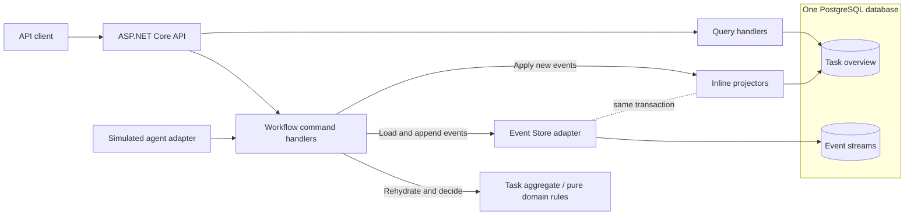

# EventForge

[](https://github.com/FarazLoloei/eventforge-event-sourcing-demo/actions/workflows/ci.yml)


[GitHub repository](https://github.com/FarazLoloei/eventforge-event-sourcing-demo)

**An architectural proposal for deterministic, auditable AI-assisted software workflows.**

> **Project status: Planning / Work in Progress**  
> **Implementation status: Early scaffolding (EVF-5, EVF-14, EVF-15, EVF-16, EVF-17).** The repository contains architecture and delivery documentation, a .NET 10 solution with one ASP.NET Core host (process-liveness health endpoint; built-in DI with build and scope validation, no module services registered), empty module and adapter projects, an xUnit project with static architecture dependency tests, and a baseline GitHub Actions workflow (restore, Release build, xUnit tests; see [Continuous integration](#continuous-integration)). No workflow behavior, database schema, domain or PostgreSQL tests, or PostgreSQL, event-contract, concurrency or replay quality gates are claimed to exist yet. See [Local setup](#local-setup) and [Architecture tests](#architecture-tests).

EventForge is an independent portfolio project exploring how **Event Sourcing, CQRS, Domain-Driven Design (DDD), and a Modular Monolith** can provide a reliable foundation for an AI-assisted software development workflow.

The first implementation will use **C# / .NET 10 and PostgreSQL**. AI agents will be **simulated**: the goal is to demonstrate the correctness of the workflow engine, not to integrate an LLM service.

## Why this project?

An AI-assisted software workflow may involve multiple steps: creating a task, assigning an agent, generating an artifact, running tests, and deciding whether the task can be completed. These steps should remain explainable when a process fails, retries, or evolves.

A mutable `status` field alone does not explain how a task reached its current state. EventForge proposes a complementary approach:

- **Events record facts** about what happened to a task.
- **Aggregates enforce rules** governing which transitions are valid.
- **Projections derive query-friendly views** from the recorded events.
- **Replay rebuilds state** without re-running external or AI-generated side effects.
- **Optimistic concurrency** prevents conflicting updates to the same event stream.

## Example workflow

A sample task might produce the following event stream:

```text
TaskCreated
    -> TaskAssigned
    -> CodeGenerated (generationId: g1)
    -> TestsFailed   (generationId: g1)
    -> CodeGenerated (generationId: g2)
    -> TestsPassed   (generationId: g2)
    -> TaskCompleted
```

Events are immutable, versioned facts. Assignment precedes generation; tests must refer to the current generation, and completion requires that generation to have passed. Examples and artifact references are synthetic.

## Proposed architecture



**One deployable process; one PostgreSQL database.** Command handlers orchestrate the aggregate, event store, and inline projectors. Event append and task overview updates commit in the **same database transaction**; any failure rolls back both, and success is returned only after commit.

Arrows show conceptual execution flow, not source-code dependencies. Handlers use application contracts for persistence; infrastructure implements those contracts. The aggregate remains pure and independent of HTTP, SQL, and simulation. All components remain proposed and unimplemented.

### Proposed stack

| Area | Technology |
| --- | --- |
| Language / runtime | C# / .NET 10 |
| HTTP API | ASP.NET Core Web API |
| Primary data store | PostgreSQL (including JSONB event payloads) |
| Architecture | Modular Monolith, DDD, Event Sourcing, CQRS |
| Local database environment | Docker Compose |
| Tests | xUnit; unit and PostgreSQL integration tests |
| Continuous integration | GitHub Actions |

## Planned capabilities

The MVP will provide explicit lifecycle commands, simulated outcomes, status queries, optimistic stream concurrency, and transactional inline projections. It will include event schema versioning with explicit upcasters, controlled side-effect-free replay, deterministic projection diffing, and recovery validated against authoritative history.

Domain, PostgreSQL, concurrency, replay, and architecture tests will grow incrementally. Engineering guardrails, reproducible local setup, and GitHub Actions are MVP requirements.

Snapshots, durable request idempotency, online projection rebuilding, event branching, isolated preview environments, and controlled side-effect execution are deferred. All capabilities remain proposed; see [the roadmap](docs/roadmap.md) for acceptance criteria.

## Local setup

**Prerequisite:** .NET SDK 10.0.404. `global.json` pins this version and allows only later patch releases (`rollForward: latestPatch`, no prerelease). No database, Docker, or credentials are required.

Run from the repository root:

```powershell
dotnet restore EventForge.slnx
dotnet build EventForge.slnx --no-restore
dotnet test EventForge.slnx --no-build --no-restore
dotnet run --project src/EventForge.Api --no-build --no-launch-profile -- --urls http://127.0.0.1:5080
```

In a separate terminal, verify the health endpoint:

```powershell
curl.exe -i http://127.0.0.1:5080/health
```

Expected result: `HTTP/1.1 200 OK` with the body `Healthy`. The endpoint reports basic process liveness only; it does not check a database or any external service.

Verified locally with SDK 10.0.404 (EVF-17), run from the repository root:

```powershell
dotnet restore EventForge.slnx --force
dotnet build EventForge.slnx --no-restore --no-incremental
dotnet test EventForge.slnx --no-build --no-restore
dotnet build EventForge.slnx -c Release --no-restore --no-incremental
dotnet test EventForge.slnx -c Release --no-build --no-restore
```

- Debug and Release builds: 0 warnings, 0 errors.
- Debug tests: 33 passed, 0 failed, 0 skipped. Release tests: 33 passed, 0 failed, 0 skipped.
- Host started separately with `ASPNETCORE_ENVIRONMENT` and `DOTNET_ENVIRONMENT` both set: Development (Debug build) and Production (Release build) each logged the matching hosting environment, and `GET /health` returned `200 OK` with body `Healthy`. The health checks were manual.

### Dependency injection

`src/EventForge.Api/Program.cs` is the composition root and uses the built-in ASP.NET Core container. `ValidateOnBuild` and `ValidateScopes` are enabled explicitly in all environments. The only registered service is the health-check infrastructure (`AddHealthChecks()`); Workflow, Infrastructure and Simulation registrations are deferred until real services exist, and nothing for them is registered or validated today.

Policy for future services: concrete services are registered explicitly in the API; Application owns its ports and adapters implement them; services use constructor injection; the domain is independent of the container; singletons must be safe for concurrent use; scoped services use a request or unit-of-work lifetime; circular and captive scoped dependencies are forbidden. Lifetimes are chosen from actual implementations. These options give baseline validation only: they do not guarantee every runtime dependency path, factory implementation or open generic registration is valid. See [the architecture document](docs/architecture.md#composition-root-and-dependency-injection-evf-17).

### Implementation status

| Area | Status |
| --- | --- |
| Solution (`EventForge.slnx`) and SDK pin (`global.json`) | Implemented |
| ASP.NET Core host (`src/EventForge.Api`) with `/health` liveness endpoint | Implemented |
| Project scaffolding: `EventForge.Workflow` (Domain/Application folders), `EventForge.Infrastructure`, `EventForge.Simulation`, with the project references below | Implemented (empty; no types or behavior) |
| Workflow domain and application behavior, adapter implementations | Not implemented |
| Static architecture dependency tests (`tests/EventForge.UnitTests`, EVF-16) | Implemented; limited to the checks listed under [Architecture tests](#architecture-tests) |
| Domain behavior tests, PostgreSQL integration tests | Not implemented |
| PostgreSQL, Docker Compose, event store, projections, replay, upcasting | Not implemented |
| REST workflow endpoints, authentication and authorization | Not implemented |
| Composition root with built-in DI, `ValidateOnBuild`/`ValidateScopes` (EVF-17) | Implemented; only health checks registered |
| Module and adapter service registration | Not implemented (deferred until concrete services exist) |
| Baseline GitHub Actions workflow (`.github/workflows/ci.yml`, EVF-5) | Implemented in the repository; remote execution not yet observed (see [Continuous integration](#continuous-integration)) |
| CI quality gates for PostgreSQL integration, event contracts/upcasting, concurrency and replay/diffing | Not implemented (future gates, added with each capability) |

### Continuous integration

`.github/workflows/ci.yml` (workflow `CI`) is the baseline pipeline. It runs on push to `main`, on pull requests targeting `main`, and on manual dispatch, on `ubuntu-24.04` with `contents: read` permissions and no secrets. Actions are pinned to release commit SHAs, and checkout credentials are not persisted. Steps: install the SDK from `global.json`, restore `EventForge.slnx`, build in Release, run all xUnit tests (including the architecture tests) and upload the TRX results as the `test-results-trx` artifact, also when tests fail. Build and test failures fail the job.

**Status:** the workflow file is implemented but has not yet been observed running on GitHub; the badge above reflects the real run state. No branch protection or required-check enforcement is configured by the repository. There is no deployment or CD.

**Not covered yet:** PostgreSQL integration tests, event-contract and upcaster compatibility checks, optimistic-concurrency tests, and replay/projection-diff verification are future quality gates. They will be added with the capabilities they verify and are not part of this baseline.

### Solution structure

```text
src/
  EventForge.Api/             # Only executable; composition root; /health
  EventForge.Workflow/        # Task Workflow bounded context (one assembly)
    Domain/                   # EventForge.Workflow.Domain (README only)
    Application/              # EventForge.Workflow.Application (README only)
  EventForge.Infrastructure/  # Future persistence and transaction adapters
  EventForge.Simulation/      # Future synthetic agent/test-outcome adapters
tests/
  EventForge.UnitTests/       # xUnit; architecture dependency tests only (no production references)
```

Direct project references:

| Project | References |
| --- | --- |
| EventForge.Api | Workflow, Infrastructure, Simulation |
| EventForge.Workflow | None |
| EventForge.Infrastructure | Workflow |
| EventForge.Simulation | Workflow |

Task Workflow is the only bounded context; Simulation is an adapter. Application may depend inward on Domain; Domain depends on neither Application, the API, adapters, HTTP, nor SQL libraries; Infrastructure and Simulation depend inward on Workflow and not on each other or the API.

### Architecture tests

`tests/EventForge.UnitTests` holds the only test project. Its tests read the repository's own files at run time; they reference no production project and do not use Graphify.

**Implemented checks** (one shared checker, `ArchitectureRuleChecker`, is used by both the production tests and the fixtures):

- **Project references:** the actual `.csproj` files, parsed as XML, must match the approved matrix above exactly. Unexpected or missing references, circular references, production references to test projects, unresolved projects and unsupported MSBuild constructs are reported.
- **Namespace dependencies:** Roslyn syntax trees and semantic models over `src/**/*.cs` (excluding `bin`, `obj` and generated files), resolved against the .NET framework assemblies. Domain must not depend on Application, API, Infrastructure, Simulation, `Microsoft.AspNetCore`, `System.Net.Http`, `System.Data`, Npgsql, Entity Framework Core or common SQL client namespaces. Application must not depend on API, Infrastructure or Simulation. Infrastructure and Simulation must not depend on each other or on the API. Folder-to-namespace ownership is also checked using the fully resolved namespace of each top-level type (nested namespace blocks are accepted). Hand-written Workflow source outside `Workflow/Domain/` and `Workflow/Application/` is rejected, and API files may not declare Workflow, Infrastructure or Simulation namespaces (the top-level `Program.cs` declares none). Violations report file, line, source namespace, target and rule.
- **Fail-closed analysis:** a compilation error in a rule-scoped file is reported as `analysis-incomplete` rather than silently passing.

**Fixture coverage:** synthetic sources (compiled in an isolated context, never added to the production projects) run through the same checker. One valid layout and one valid nested-namespace layout are accepted; 20 forbidden scenarios are each rejected for the intended rule on exactly the marked lines (Domain to Application, HTTP, SQL, Npgsql, Entity Framework, Infrastructure and Simulation; Application to API; Infrastructure and Simulation to each other; alias, fully qualified, unqualified and implicit-using references; references in fields, parameters, return types, base types, generic arguments and member access; namespace mismatch; unresolved symbol; Workflow root files declaring Domain or Application namespaces; API declaring a Workflow namespace). Project-reference fixtures cover an outward dependency, a circular dependency, a production-to-test reference, a missing reference, an unresolved reference and a conditional reference.

**Current absence of domain code:** at the time of EVF-16 the production scan analyzed 1 file (`EventForge.Api/Program.cs`, no types) and **0 files and 0 types** in Workflow, Domain, Application, Infrastructure and Simulation. The production namespace test therefore currently proves nothing about domain isolation; the fixtures demonstrate that the checker works, and the production check becomes meaningful as types are added.

**Limitations:** static analysis only. It does not evaluate MSBuild (conditions, imports and `Directory.Build.props` are not expanded; a conditional `ProjectReference` or an `Import` in a project file is reported rather than followed), does not inspect `PackageReference` items, does not detect reflection, dynamically loaded assemblies or runtime behavior, and does not cover every framework namespace. The checker assumes `ImplicitUsings` as enabled by the SDK. All source files are analyzed in one combined Roslyn compilation that references only the .NET framework assemblies: no NuGet package or project references are loaded, so a type from an unreferenced package is an unresolved symbol (reported as `analysis-incomplete` in rule-scoped layers, never as a pass), the same simple type name in different layers is not isolated per project, and `Api` files are only checked for namespace ownership, not dependencies. The baseline CI workflow runs these tests as part of the xUnit suite, but they do not replace human review.

## Engineering principles

Events are authoritative; projections are disposable. Domain decisions and event application use explicit inputs and persisted facts. Event append and inline projection updates share one transaction. Replay never calls agents, regenerates artifacts, or reruns tests. Module boundaries, automated checks, and human review apply to agent-produced changes.

## Conceptual mapping to Go

The proposed implementation remains C#/.NET 10. This is a conceptual mapping to idiomatic Go, not an implemented Go port or a change to the architectural baseline.

- **Pure domain functions:** Express `Decide(state, command)` and `Apply(state, event)` as deterministic functions over explicit values. Supply time, identifiers, and outcomes as inputs; keep I/O and request contexts outside the reducers. Avoid mutating shared slices or maps through copied structs.
- **Structs and composition:** Represent commands, events, and state with structs. Wire concrete adapters into application services through explicit constructor parameters. Define small interfaces in the consuming package only where an abstraction is needed.
- **Explicit errors:** Return domain rejections as explicit results or typed errors and check every returned error. Distinguish business rejection, version conflict, cancellation, and infrastructure failure; reserve panics for programming faults.
- **Transactions:** Keep event append and inline projection updates on the same PostgreSQL connection and transaction, using parameterized SQL. Roll back on failure and report success only after commit; preserve expected-version checks and reject stale decisions without automatic retries.
- **Concurrency and cancellation:** Pass `context.Context` explicitly to I/O operations for deadlines and cancellation. Use bounded goroutines only for independent work with clear ownership and shutdown; preserve per-stream event order and avoid concurrent use of a command transaction. Cancellation or a lost response cannot establish whether a commit succeeded and does not provide request idempotency.

These conventions follow [Go code review guidance](https://go.dev/wiki/CodeReviewComments) and [Go transaction guidance](https://go.dev/doc/database/execute-transactions). The same domain boundaries, event contracts, and replay guarantees would apply.

## Documentation

- [Architecture and data-flow proposal](docs/architecture.md)
- [Implementation roadmap and MVP acceptance criteria](docs/roadmap.md)
- [ADR 0001: Architectural foundation](docs/adr/0001-architecture.md)
- [AI agent governance and engineering rules](AGENTS.md) (documented policy; automated enforcement is not implemented).

## Independence and intellectual property

EventForge is an **independent, original demonstration** informed by general professional engineering experience. It is **not copied or derived from a previous employer's proprietary source code, private schemas, internal documentation, or confidential business data**. Any future examples and fixtures will be newly authored and synthetic. This repository is not an official project of, or endorsed by, any employer or prospective employer.
