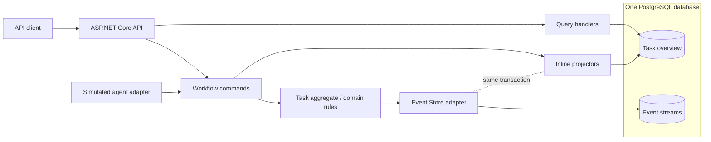

# EventForge

[GitHub repository](https://github.com/FarazLoloei/eventforge-event-sourcing-demo)

**An architectural proposal for deterministic, auditable AI-assisted software workflows.**

> **Project status: Planning / Work in Progress**  
> **Implementation status: Not started.** This repository currently contains architecture and delivery documentation only. No runnable API, database schema, automated tests, or CI pipeline is claimed to exist yet.

EventForge is an independent portfolio project exploring how **Event Sourcing, CQRS, Domain-Driven Design (DDD), and a Modular Monolith** can provide a reliable foundation for an AI-assisted software development workflow.

The first implementation will use **C# / .NET 10 and PostgreSQL**. AI agents will be **simulated**: the goal is to demonstrate the correctness of the workflow engine, not to integrate an LLM service.

## Why this project?

An AI-assisted software workflow may involve multiple steps: creating a task, assigning an agent, generating an artifact, running tests, and deciding whether the task can be completed. These steps should remain explainable when a process fails, retries, or evolves.

A mutable `status` field alone does not explain how a task reached its current state. EventForge proposes a complementary approach:

- **Events record facts** about what happened to a task.
- **Aggregates enforce rules** governing which transitions are valid.
- **Projections derive query-friendly views** from the recorded events.
- **Replay rebuilds state** without re-running external or AI-generated side effects.
- **Optimistic concurrency** prevents conflicting updates to the same event stream.

This is a deliberately small architectural demonstration, not a claim that Event Sourcing is appropriate for every domain.

## Example workflow

A sample task might produce the following event stream:

```text
TaskCreated
    -> TaskAssigned
    -> CodeGenerated (generationId: g1)
    -> TestsFailed   (generationId: g1)
    -> CodeGenerated (generationId: g2)
    -> TestsPassed   (generationId: g2)
    -> TaskCompleted
```

Each event is an immutable, versioned domain fact. The planned domain rules include:

1. A task must be created before it can be assigned.
2. Code generation requires an assigned task.
3. A test result must refer to the task's **current generation**.
4. A task can be completed only when the current generation has passed its tests.
5. Repeating a failed command must not silently corrupt the event stream.

The task identifiers and agent actions in demonstrations will be synthetic. A `CodeGenerated` event will reference an artifact, not embed proprietary or generated source code.

## Proposed architecture



**One deployable process; one PostgreSQL database.** Events and the initial task-list projection are intended to be committed in the **same database transaction**. The diagram is conceptual; these components have not been implemented.

### Logical modules

| Module / boundary | Responsibility |
| --- | --- |
| **Workflow** (domain boundary) | Task aggregate, lifecycle rules, commands, domain events, and ownership of workflow read-model definitions. |
| **Execution Simulation** (supporting adapter) | Produces simulated agent and test outcomes through the same public workflow commands as any other caller. No separate persistent execution domain in the MVP. |
| **Event Storage / Projections** (infrastructure) | PostgreSQL event persistence, version checks, transactional projection updates, and replay support. |
| **API** (delivery adapter) | REST endpoints, command validation, consistent errors, and read queries. |

The boundaries are intentionally conservative. An independent Execution bounded context will be introduced only if its rules and lifecycle justify it.

### Proposed stack

| Area | Technology |
| --- | --- |
| Language / runtime | C# / .NET 10 |
| HTTP API | ASP.NET Core Web API |
| Primary data store | PostgreSQL (including JSONB event payloads) |
| Architecture | Modular Monolith, DDD, Event Sourcing, CQRS |
| Local database environment | Docker Compose |
| Tests | xUnit; unit and PostgreSQL integration tests |
| Continuous integration | GitHub Actions |

No broker, Kubernetes cluster, event-sourcing framework, or actual LLM dependency is required for the first demonstration.

## Planned capabilities

### First working demonstration (MVP)

- Create, assign, and complete a task through explicit commands.
- Record code-generation and test-outcome events from a simulated agent.
- Persist ordered event streams in PostgreSQL with optimistic version checks.
- Update a task overview read model transactionally with event writes.
- Query current task status through the API.
- Rebuild a projection deterministically from persisted events in a controlled, write-paused process.
- Prove core invariants, concurrency rejection, and replay equivalence through automated tests.
- Run the API and database locally and validate the build with GitHub Actions.

### Later architectural extensions

- Event schema versioning with explicit, tested upcasters.
- Aggregate snapshots as a performance optimization.
- Request idempotency and more extensive concurrent-write validation.
- Online projection rebuilding under active load using a commit-safe catch-up mechanism.
- Optional event branching, isolated previews, controlled side effects, and AI-agent engineering guardrails.

These features are **proposals**, not existing functionality. See [the roadmap](docs/roadmap.md) for delivery order and acceptance criteria.

## Engineering principles

- **Events are the source of truth.** Read models are disposable and derivable.
- **Keep domain decisions deterministic.** Time, random IDs, and external outputs become explicit command inputs or persisted facts.
- **Atomic local consistency before distributed coordination.** A committed event must not leave its corresponding inline projection behind.
- **Replay must be side-effect free.** Replaying a `CodeGenerated` event never regenerates code or reruns a test.
- **Prefer simple infrastructure.** Add queues, distributed locks, or cross-service boundaries only when a measured requirement calls for them.
- **Treat agent-produced changes as untrusted inputs.** Any future real agent integration must pass through explicit domain commands, validation, review, and tests.

## Documentation

- [Architecture and data-flow proposal](docs/architecture.md)
- [Implementation roadmap and MVP acceptance criteria](docs/roadmap.md)
- [ADR 0001: Architectural foundation](docs/adr/0001-architecture.md)

## Repository state and next steps

### Phase 1 review workflow

Phase 1 is limited to the architecture proposal and repository documentation. The project owner performs all Git operations and Jira management manually, including repository initialization or cloning, branch creation, staging, commits, pushes, merges, and Pull Requests. Phase 2 implementation requires separate approval.

The prepared repository templates are [the commit message template](.gitmessage) and [the Pull Request template](.github/PULL_REQUEST_TEMPLATE.md). Their example Jira keys are placeholders; replace them with the actual issue key before use. The presence of `.gitmessage` does not configure Git to use it.

**Current milestone: Phase 1 — documentation only.** The repository is suitable for reviewing the architectural proposal, but **there is no application to run yet**.

Once implementation is explicitly approved, the plan is to create the .NET solution, PostgreSQL Docker configuration, event store, workflow aggregate, API, projections, replay tooling, tests, and CI in small, verifiable increments. The intended delivery order is documented in [docs/roadmap.md](docs/roadmap.md).

## Independence and intellectual property

EventForge is an **independent, original demonstration** informed by general professional engineering experience. It is **not copied or derived from a previous employer's proprietary source code, private schemas, internal documentation, or confidential business data**. Any future examples and fixtures will be newly authored and synthetic. This repository is not an official project of, or endorsed by, any employer or prospective employer.
