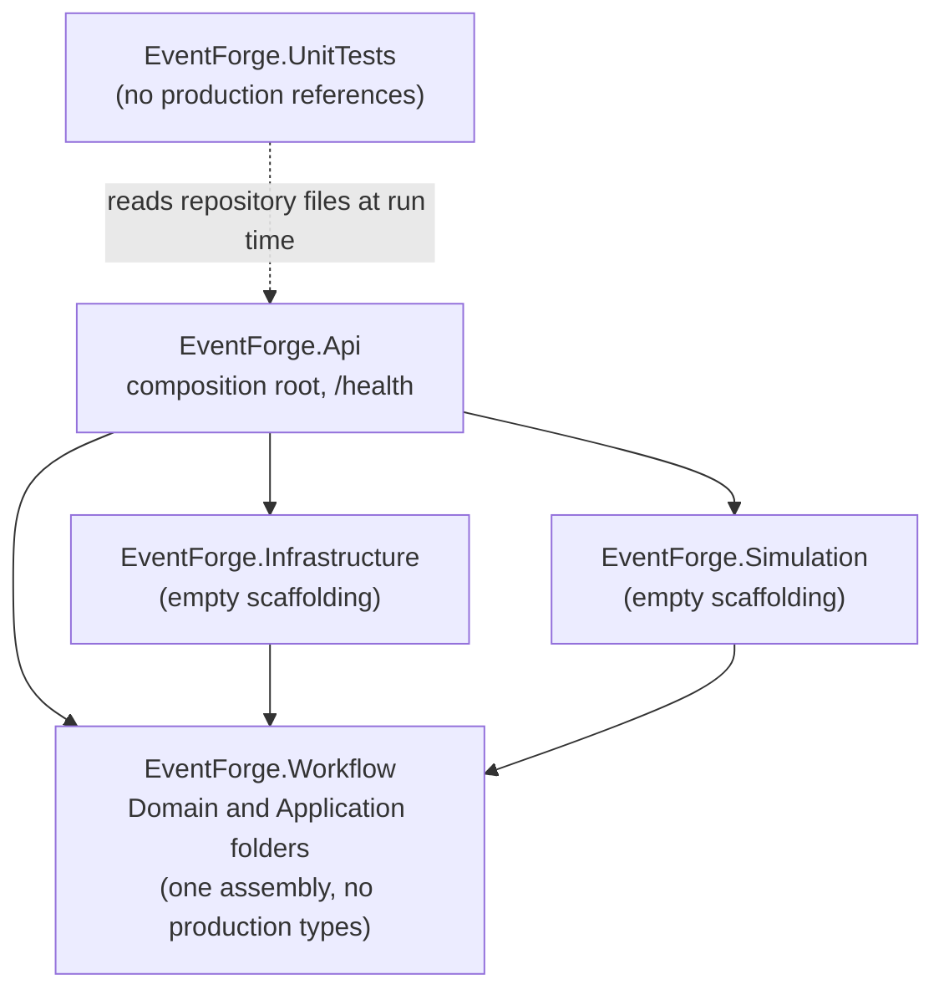
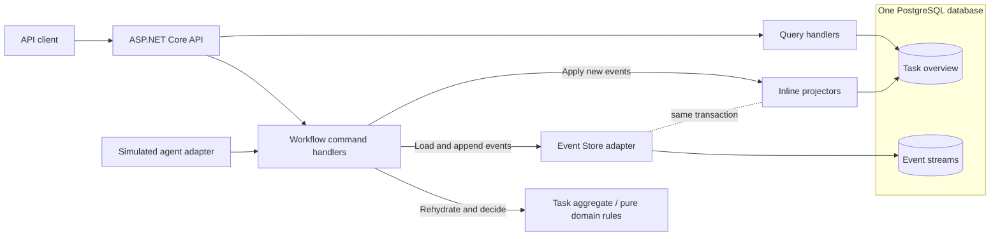
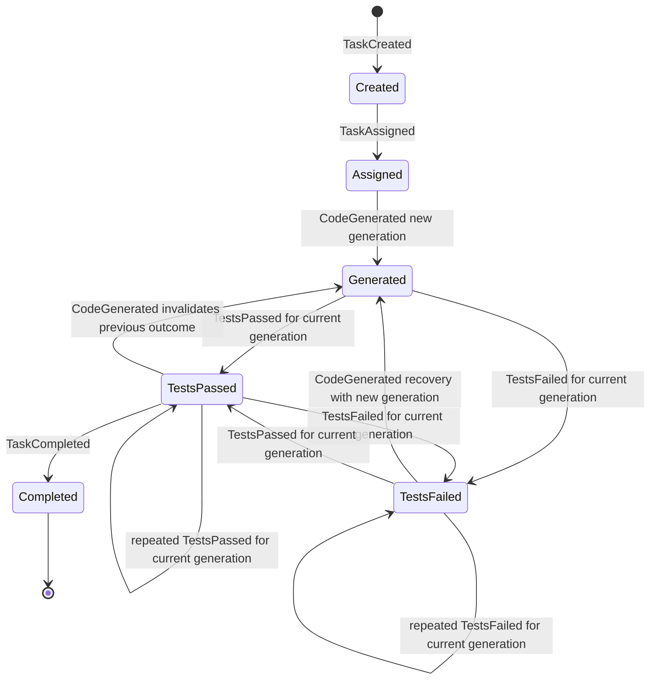

# EventForge

[](https://github.com/FarazLoloei/eventforge-event-sourcing-demo/actions/workflows/ci.yml)


**Building a deterministic, auditable, event-driven foundation for AI-assisted software engineering workflows.**

EventForge is an independent portfolio project exploring how **Event Sourcing, CQRS, Domain-Driven Design (DDD) and a Modular Monolith** can provide a reliable foundation for an AI-assisted software development workflow. The planned implementation uses **C# / .NET 10 and PostgreSQL**. AI agents will be **simulated**: the goal is to demonstrate the correctness of the workflow engine, not to integrate an LLM service.

> **Current status: Active development — engineering foundation implemented, workflow behavior planned.**
> The repository contains a verified .NET 10 solution, a minimal ASP.NET Core host, Clean Architecture project scaffolding, validated dependency injection, automated architecture dependency tests and a working GitHub Actions baseline CI pipeline. **EventForge is not yet a working workflow engine:** no domain behavior, event store, database, projections or workflow endpoints exist. Everything under [Why EventForge?](#why-eventforge), [Architecture](#architecture) (planned runtime and lifecycle) and [Roadmap](#roadmap) describes intended design, not delivered functionality.

## Engineering highlights

- **Verified baseline:** .NET 10 SDK pinned by `global.json`; Release build with 0 warnings and 0 errors and 33 passing tests, confirmed locally and in GitHub Actions (see [Continuous integration](#continuous-integration)).
- **Architecture enforced by tests:** project references and namespace dependencies are checked from the real `.csproj` files and Roslyn semantic analysis, including fixtures that prove forbidden dependencies are rejected.
- **Clean Architecture from the first commit:** Workflow owns the domain; HTTP, persistence and simulation are adapters that depend inward.
- **Fail-closed validation:** built-in DI with `ValidateOnBuild` and `ValidateScopes`; static analysis reports `analysis-incomplete` rather than silently passing.
- **Documented governance:** Jira-linked delivery, human-controlled Git and pull requests, explicit architectural approval and AI-agent rules (see [AI-assisted engineering and governance](#ai-assisted-engineering-and-governance)).
- **Honest status reporting:** every capability is labelled implemented or planned; nothing is claimed without verification.

## Current implementation

### Implemented and verified

| Area | Status |
| --- | --- |
| .NET 10 solution (`EventForge.slnx`) and SDK pin (`global.json`) | Implemented |
| Minimal ASP.NET Core host (`src/EventForge.Api`) | Implemented |
| `/health` endpoint (process liveness only; no database or dependency checks) | Implemented |
| Clean Architecture project scaffolding (`Workflow`, `Infrastructure`, `Simulation`) with the project references below | Implemented (empty; no production types) |
| Native DI with `ValidateOnBuild` and `ValidateScopes` (EVF-17) | Implemented; only health checks are explicitly registered |
| xUnit project with Roslyn-based architecture dependency tests (EVF-16) | Implemented; limited to the checks in [Automated architecture validation](#automated-architecture-validation) |
| GitHub Actions baseline CI with TRX test-result artifacts (EVF-5) | Implemented and operational; see the limits under [Continuous integration](#continuous-integration) |
| Engineering governance documents ([AGENTS.md](AGENTS.md), PR and commit templates) | Documented; enforcement is partial (see [governance](#ai-assisted-engineering-and-governance)) |

### Planned, not implemented

| Area | Status |
| --- | --- |
| PostgreSQL and Docker Compose | Planned |
| Event store (append/load, envelope, unique stream-version constraint) | Planned |
| Domain aggregates and workflow behavior | Planned |
| CQRS command/query handlers and REST workflow endpoints | Planned |
| Optimistic concurrency (expected stream versions) | Planned |
| Transactional inline projections | Planned |
| Event versioning and upcasting | Planned |
| Deterministic replay and projection recovery | Planned |
| Domain tests and PostgreSQL integration tests | Planned |
| Authentication and authorization | Planned (identity mechanism needs owner review) |
| Required status checks, branch protection, controlled CI failure verification | Pending |
| PostgreSQL, event-contract, concurrency and replay CI quality gates | Not implemented |
| CD and deployment | Not implemented |

Snapshots, durable request idempotency, online projection rebuilding, event branching, isolated previews and controlled side effects are deferred beyond the MVP.

## Why EventForge?

An AI-assisted software workflow involves several steps: creating a task, assigning an agent, generating an artifact, running tests and deciding whether the task can be completed. These steps must remain explainable when a process fails, retries or evolves. A mutable `status` field alone does not explain how a task reached its current state. EventForge proposes a complementary approach:

- **Events record facts** about what happened to a task.
- **Aggregates enforce rules** governing which transitions are valid.
- **Projections derive query-friendly views** from the recorded events.
- **Replay rebuilds state** without re-running external or AI-generated side effects.
- **Optimistic concurrency** prevents conflicting updates to the same event stream.

Guiding principle: events are authoritative; projections are disposable.

## Architecture

### Implemented project dependencies

These are the actual direct project references, enforced by the architecture tests. Arrows point from the referencing project to the referenced project.



| Project | Direct project references |
| --- | --- |
| EventForge.Api | Workflow, Infrastructure, Simulation |
| EventForge.Infrastructure | Workflow |
| EventForge.Simulation | Workflow |
| EventForge.Workflow | None |

Domain and Application currently share the single `EventForge.Workflow` assembly, separated by folder and namespace, and contain no production types. Further internal dependencies (for example Application depending inward on Domain, or Infrastructure implementing Application-owned ports) are **intended rules, not existing code**. The dotted test edge is not a project reference.

### Planned runtime architecture

> **Planned, not implemented.** Arrows show conceptual execution flow, not source-code dependencies.



**One deployable process; one PostgreSQL database.** Command handlers orchestrate the aggregate, event store and inline projectors. Event append and task overview updates commit in the **same database transaction**; any failure rolls back both, and success is returned only after commit. Handlers use application contracts for persistence and infrastructure implements them. The aggregate remains pure and independent of HTTP, SQL and simulation. The simulator uses the same command boundary as the API.

Planned design guarantees (see [the architecture document](docs/architecture.md) for details):

- Invalid commands append no events; `Decide(state, command)` and `Apply(state, event)` are pure and deterministic.
- Expected stream versions, contiguous appended versions and a unique `(stream_type, stream_id, stream_version)` constraint; stale writers are rejected with a conflict (HTTP 409) and are not silently retried. Optimistic concurrency is not durable request idempotency.
- Stable event types, explicit schema versions and explicit, tested upcaster chains; unknown versions, missing steps and malformed events fail explicitly.
- Replay pauses writers, rebuilds a shadow projection from supported history, validates it against history and independent reference expectations, and never invokes agents, regenerates artifacts, runs tests or sends notifications.

### Planned task lifecycle

> **Planned, not implemented.** Assignment precedes generation. Tests refer to the current generation, and a new generation invalidates the previous test outcome. Commands that violate a rule are rejected and append nothing.



Repeated test outcomes for the current generation are permitted, and the latest outcome decides completion eligibility. Completion is terminal and requires the latest test outcome of the current generation to be passed. Projection damage is a separate maintenance concern: a damaged task overview is rebuilt from authoritative history through the controlled replay and cutover procedure in the [architecture document](docs/architecture.md#6-replay-rebuilding-and-schema-evolution), never by editing events.

## Example workflow

A sample task might produce the following event stream (synthetic example):

```text
TaskCreated
    -> TaskAssigned
    -> CodeGenerated (generationId: g1)
    -> TestsFailed   (generationId: g1)
    -> CodeGenerated (generationId: g2)
    -> TestsPassed   (generationId: g2)
    -> TaskCompleted
```

Events are immutable, versioned facts. Examples and artifact references are synthetic.

## Technology stack

| Area | Technology | Status |
| --- | --- | --- |
| Language / runtime | C# / .NET 10 (SDK 10.0.404 pinned) | In use |
| HTTP | ASP.NET Core | In use (health endpoint only) |
| Tests | xUnit, Roslyn (architecture tests) | In use |
| Continuous integration | GitHub Actions | In use (baseline) |
| Architecture style | Modular Monolith, DDD, Event Sourcing, CQRS, Clean Architecture | Structure in place; behavior planned |
| Primary data store | PostgreSQL (including JSONB event payloads) | Planned |
| Local database environment | Docker Compose | Planned |

## Repository structure

```text
src/
  EventForge.Api/             # Only executable; composition root; /health
  EventForge.Workflow/        # Task Workflow bounded context (one assembly)
    Domain/                   # EventForge.Workflow.Domain (README only)
    Application/              # EventForge.Workflow.Application (README only)
  EventForge.Infrastructure/  # Future persistence and transaction adapters
  EventForge.Simulation/      # Future synthetic agent/test-outcome adapters
tests/
  EventForge.UnitTests/       # xUnit; architecture dependency tests only (no production references)
docs/                         # Architecture, roadmap, ADR 0001
.github/workflows/ci.yml      # Baseline CI
```

Task Workflow is the only bounded context; Simulation is an adapter. Domain depends on neither Application, the API, adapters, HTTP nor SQL libraries; Infrastructure and Simulation depend inward on Workflow and not on each other or the API.

## Getting started

**Prerequisite:** .NET SDK 10.0.404. `global.json` pins this version and allows only later patch releases (`rollForward: latestPatch`, no prerelease). No database, Docker or credentials are required.

Run from the repository root:

```powershell
dotnet restore EventForge.slnx
dotnet build EventForge.slnx --no-restore
dotnet test EventForge.slnx --no-build --no-restore
dotnet run --project src/EventForge.Api --no-build --no-launch-profile -- --urls http://127.0.0.1:5080
```

In a separate terminal, verify the health endpoint:

```powershell
curl.exe -i http://127.0.0.1:5080/health
```

Expected result: `HTTP/1.1 200 OK` with the body `Healthy`. The endpoint reports basic process liveness only; it does not check a database or any external service.

**Verified locally (Windows, SDK 10.0.404).** From the repository root:

```powershell
dotnet restore EventForge.slnx --force
dotnet build EventForge.slnx --no-restore --no-incremental
dotnet test EventForge.slnx --no-build --no-restore
dotnet build EventForge.slnx -c Release --no-restore --no-incremental
dotnet test EventForge.slnx -c Release --no-build --no-restore
```

- Debug and Release builds: 0 warnings, 0 errors. Debug and Release tests: 33 passed, 0 failed, 0 skipped.
- Host started with `ASPNETCORE_ENVIRONMENT` and `DOTNET_ENVIRONMENT` set to Development (Debug build) and Production (Release build): each logged the matching hosting environment and `GET /health` returned `200 OK` with body `Healthy`. These health checks were manual.
- A fresh-clone Release build, test run and Production health verification also passed.

## Dependency injection

`src/EventForge.Api/Program.cs` is the composition root and uses the built-in ASP.NET Core container. `ValidateOnBuild` and `ValidateScopes` are enabled explicitly in all environments. The only explicit service registration is the health-check infrastructure (`AddHealthChecks()`); Workflow, Infrastructure and Simulation registrations are deferred until real services exist, and nothing for them is registered or validated today.

Policy for future services: concrete services are registered explicitly in the API; Application owns its ports and adapters implement them; services use constructor injection; the domain is independent of the container; singletons must be safe for concurrent use; scoped services use a request or unit-of-work lifetime; circular and captive scoped dependencies are forbidden. Lifetimes are chosen from actual implementations. These options give baseline validation only: they do not guarantee that every runtime dependency path, factory implementation or open generic registration is valid. See [the architecture document](docs/architecture.md#composition-root-and-dependency-injection-evf-17).

## Continuous integration

`.github/workflows/ci.yml` (workflow `CI`) is the baseline pipeline. It runs on push to `main`, on pull requests targeting `main` and on manual dispatch, on `ubuntu-24.04` with `contents: read` permissions and no secrets. Actions are pinned to release commit SHAs and checkout credentials are not persisted.


Build and test failures fail the job. The TRX results are uploaded as the `test-results-trx` artifact, also when tests fail.

### Verified baseline results (November 19, 2026)

The following were independently verified from the GitHub Actions logs:

| Check | Result |
| --- | --- |
| SDK | 10.0.404 |
| GitHub-hosted runner | Ubuntu 24.04 |
| Restore | Passed |
| Release build | Passed |
| Build warnings | 0 |
| Build errors | 0 |
| Tests passed | 33 |
| Tests failed | 0 |
| Tests skipped | 0 |
| TRX artifact upload | Successful |

Both the pull request run and the `main` push run completed successfully:

- [Pull request CI run](https://github.com/FarazLoloei/eventforge-event-sourcing-demo/actions/runs/44484566029)
- [Main CI run](https://github.com/FarazLoloei/eventforge-event-sourcing-demo/actions/runs/44484880631)
- [Merged pull request #11](https://github.com/FarazLoloei/eventforge-event-sourcing-demo/pull/11)

### Remaining CI limitations

EVF-5 is **in progress** and is not marked complete. Still pending or not implemented:

- Controlled CI failure verification.
- Required status checks and branch protection. None are configured; they require separate project-owner approval and are not EVF-5 closure requirements.
- PostgreSQL integration tests, event-contract and upcaster compatibility checks, optimistic-concurrency tests and replay/projection-diff verification; these quality gates will be added with the capabilities they verify.
- CD and deployment.

## Automated architecture validation

`tests/EventForge.UnitTests` holds the only test project. Its tests read the repository's own files at run time; they reference no production project and do not use Graphify. One shared checker, `ArchitectureRuleChecker`, serves both the production tests and the fixtures.

**Implemented checks**

- **Project references:** the actual `.csproj` files, parsed as XML, must match the approved matrix above exactly. Unexpected or missing references, circular references, production references to test projects, unresolved projects and unsupported MSBuild constructs are reported.
- **Namespace dependencies:** Roslyn syntax trees and semantic models over `src/**/*.cs` (excluding `bin`, `obj` and generated files), resolved against the .NET framework assemblies. Domain must not depend on Application, API, Infrastructure, Simulation, `Microsoft.AspNetCore`, `System.Net.Http`, `System.Data`, Npgsql, Entity Framework Core or common SQL client namespaces. Application must not depend on API, Infrastructure or Simulation. Infrastructure and Simulation must not depend on each other or on the API. Folder-to-namespace ownership is checked using the fully resolved namespace of each top-level type (nested namespace blocks are accepted). Hand-written Workflow source outside `Workflow/Domain/` and `Workflow/Application/` is rejected, and API files may not declare Workflow, Infrastructure or Simulation namespaces. Violations report file, line, source namespace, target and rule.
- **Fail-closed analysis:** a compilation error in a rule-scoped file is reported as `analysis-incomplete` rather than silently passing.

**Fixture coverage:** synthetic sources (compiled in an isolated context, never added to the production projects) run through the same checker. One valid layout and one valid nested-namespace layout are accepted; 20 forbidden scenarios are each rejected for the intended rule on exactly the marked lines (Domain to Application, HTTP, SQL, Npgsql, Entity Framework, Infrastructure and Simulation; Application to API; Infrastructure and Simulation to each other; alias, fully qualified, unqualified and implicit-using references; references in fields, parameters, return types, base types, generic arguments and member access; namespace mismatch; unresolved symbol; Workflow root files declaring Domain or Application namespaces; API declaring a Workflow namespace). Project-reference fixtures cover an outward dependency, a circular dependency, a production-to-test reference, a missing reference, an unresolved reference and a conditional reference.

**Current absence of domain code:** at the time of EVF-16 the production scan analyzed 1 file (`EventForge.Api/Program.cs`, no types) and **0 files and 0 types** in Workflow, Domain, Application, Infrastructure and Simulation. The production namespace test therefore currently proves nothing about domain isolation; the fixtures demonstrate that the checker works, and the production check becomes meaningful as types are added.

**Limitations:** static analysis only. It does not evaluate MSBuild (conditions, imports and `Directory.Build.props` are not expanded; a conditional `ProjectReference` or an `Import` in a project file is reported rather than followed), does not inspect `PackageReference` items, does not detect reflection, dynamically loaded assemblies or runtime behavior, and does not cover every framework namespace. The checker assumes `ImplicitUsings` as enabled by the SDK. All source files are analyzed in one combined Roslyn compilation that references only the .NET framework assemblies: no NuGet package or project references are loaded, so a type from an unreferenced package is an unresolved symbol (reported as `analysis-incomplete` in rule-scoped layers, never as a pass), the same simple type name in different layers is not isolated per project, and API files are only checked for namespace ownership, not dependencies. The CI workflow runs these tests as part of the xUnit suite, but they do not replace human review.

## AI-assisted engineering and governance

EventForge is developed with AI assistance under explicit, repository-specific rules in [AGENTS.md](AGENTS.md). Highlights:

- **Jira-linked delivery:** work is tied to approved Jira tasks, and commit and pull request formats reference the issue key.
- **Human-controlled Git and PR operations:** agents do not create branches, stage, commit, push, merge or open pull requests; the project owner performs them.
- **Explicit architectural approval:** significant changes (technology, module ownership, event contracts, consistency guarantees, replay strategy) require owner approval and an authorized ADR.
- **Repository-specific AI instructions and skills:** agent instructions and skills encode the architecture, event-sourcing and review rules.
- **Independent technical review:** AI-generated changes are treated as untrusted contributions and reviewed by a human.
- **Automated architecture validation:** dependency tests run locally and in CI.
- **Synthetic data and secret hygiene:** fixtures are original and synthetic; credentials, tokens and personal data stay out of events, artifacts, examples and logs.
- **Optional local Graphify navigation:** a local, code-only graph can help navigate C# sources. It is not required for building or testing, and its token-efficiency evaluation is ongoing.

**Limits:** these are documented policies. Only the build, tests and architecture checks are automated; there is no automated enforcement of the full governance policy, commit linting or required status checks, and Git templates provide guidance, not enforcement.

## Roadmap

The 12 roadmap tasks, milestones and MVP acceptance criteria are preserved in [docs/roadmap.md](docs/roadmap.md). Current status:

| Task | Area | Status |
| --- | --- | --- |
| 1 | Solution and architecture setup | Completed (EVF-13) |
| 2 | PostgreSQL and Docker configuration | Planned |
| 3 | Event Store implementation | Planned |
| 4 | Domain aggregates and event persistence | Planned |
| 5 | CQRS commands and queries | Planned |
| 6 | Transactional projections | Planned |
| 7 | Event replay and projection rebuilding | Planned |
| 8 | Event schema versioning and upcasting | Planned |
| 9 | Snapshots | Deferred (advanced) |
| 10 | Concurrency and idempotency | Deferred (advanced hardening) |
| 11 | Automated unit and integration tests | Partially implemented (architecture test baseline) |
| 12 | GitHub Actions CI and final documentation | Partially implemented (operational baseline CI; EVF-5 in progress) |

Full MVP acceptance remains pending.

## Conceptual mapping to Go

The planned implementation remains C#/.NET 10. This is a conceptual mapping to idiomatic Go, not an implemented Go port or a change to the architectural baseline.

- **Pure domain functions:** Express `Decide(state, command)` and `Apply(state, event)` as deterministic functions over explicit values. Supply time, identifiers and outcomes as inputs; keep I/O and request contexts outside the reducers. Avoid mutating shared slices or maps through copied structs.
- **Structs and composition:** Represent commands, events and state with structs. Wire concrete adapters into application services through explicit constructor parameters. Define small interfaces in the consuming package only where an abstraction is needed.
- **Explicit errors:** Return domain rejections as explicit results or typed errors and check every returned error. Distinguish business rejection, version conflict, cancellation and infrastructure failure; reserve panics for programming faults.
- **Transactions:** Keep event append and inline projection updates on the same PostgreSQL connection and transaction, using parameterized SQL. Roll back on failure and report success only after commit; preserve expected-version checks and reject stale decisions without automatic retries.
- **Concurrency and cancellation:** Pass `context.Context` explicitly to I/O operations for deadlines and cancellation. Use bounded goroutines only for independent work with clear ownership and shutdown; preserve per-stream event order and avoid concurrent use of a command transaction. Cancellation or a lost response cannot establish whether a commit succeeded and does not provide request idempotency.

These conventions follow [Go code review guidance](https://go.dev/wiki/CodeReviewComments) and [Go transaction guidance](https://go.dev/doc/database/execute-transactions). The same domain boundaries, event contracts and replay guarantees would apply.

## Documentation

- [Architecture and data-flow proposal](docs/architecture.md)
- [Implementation roadmap and MVP acceptance criteria](docs/roadmap.md)
- [ADR 0001: Architectural foundation](docs/adr/0001-architecture.md)
- [AI agent governance and engineering rules](AGENTS.md) (documented policy; automated enforcement is not implemented)
- [GitHub repository](https://github.com/FarazLoloei/eventforge-event-sourcing-demo)

## Independence and intellectual property

EventForge is an **independent, original demonstration** informed by general professional engineering experience. It is **not copied or derived from a previous employer's proprietary source code, private schemas, internal documentation or confidential business data**. Any future examples and fixtures will be newly authored and synthetic. This repository is not an official project of, or endorsed by, any employer or prospective employer.
