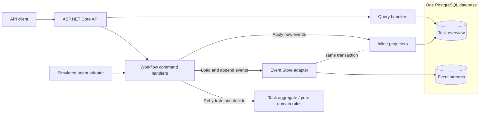

# EventForge

[GitHub repository](https://github.com/FarazLoloei/eventforge-event-sourcing-demo)

**An architectural proposal for deterministic, auditable AI-assisted software workflows.**

> **Project status: Planning / Work in Progress**  
> **Implementation status: Not started.** This repository currently contains architecture and delivery documentation only. No runnable API, database schema, automated tests, or CI pipeline is claimed to exist yet.

EventForge is an independent portfolio project exploring how **Event Sourcing, CQRS, Domain-Driven Design (DDD), and a Modular Monolith** can provide a reliable foundation for an AI-assisted software development workflow.

The first implementation will use **C# / .NET 10 and PostgreSQL**. AI agents will be **simulated**: the goal is to demonstrate the correctness of the workflow engine, not to integrate an LLM service.

## Why this project?

An AI-assisted software workflow may involve multiple steps: creating a task, assigning an agent, generating an artifact, running tests, and deciding whether the task can be completed. These steps should remain explainable when a process fails, retries, or evolves.

A mutable `status` field alone does not explain how a task reached its current state. EventForge proposes a complementary approach:

- **Events record facts** about what happened to a task.
- **Aggregates enforce rules** governing which transitions are valid.
- **Projections derive query-friendly views** from the recorded events.
- **Replay rebuilds state** without re-running external or AI-generated side effects.
- **Optimistic concurrency** prevents conflicting updates to the same event stream.

## Example workflow

A sample task might produce the following event stream:

```text
TaskCreated
    -> TaskAssigned
    -> CodeGenerated (generationId: g1)
    -> TestsFailed   (generationId: g1)
    -> CodeGenerated (generationId: g2)
    -> TestsPassed   (generationId: g2)
    -> TaskCompleted
```

Events are immutable, versioned facts. Assignment precedes generation; tests must refer to the current generation, and completion requires that generation to have passed. Examples and artifact references are synthetic.

## Proposed architecture



**One deployable process; one PostgreSQL database.** Command handlers orchestrate the aggregate, event store, and inline projectors. Event append and task overview updates commit in the **same database transaction**; any failure rolls back both, and success is returned only after commit.

Arrows show conceptual execution flow, not source-code dependencies. Handlers use application contracts for persistence; infrastructure implements those contracts. The aggregate remains pure and independent of HTTP, SQL, and simulation. All components remain proposed and unimplemented.

### Proposed stack

| Area | Technology |
| --- | --- |
| Language / runtime | C# / .NET 10 |
| HTTP API | ASP.NET Core Web API |
| Primary data store | PostgreSQL (including JSONB event payloads) |
| Architecture | Modular Monolith, DDD, Event Sourcing, CQRS |
| Local database environment | Docker Compose |
| Tests | xUnit; unit and PostgreSQL integration tests |
| Continuous integration | GitHub Actions |

## Planned capabilities

The MVP will provide explicit lifecycle commands, simulated outcomes, status queries, optimistic stream concurrency, and transactional inline projections. It will include event schema versioning with explicit upcasters, controlled side-effect-free replay, deterministic projection diffing, and recovery validated against authoritative history.

Domain, PostgreSQL, concurrency, replay, and architecture tests will grow incrementally. Engineering guardrails, reproducible local setup, and GitHub Actions are MVP requirements.

Snapshots, durable request idempotency, online projection rebuilding, event branching, isolated preview environments, and controlled side-effect execution are deferred. All capabilities remain proposed; see [the roadmap](docs/roadmap.md) for acceptance criteria.

## Engineering principles

Events are authoritative; projections are disposable. Domain decisions and event application use explicit inputs and persisted facts. Event append and inline projection updates share one transaction. Replay never calls agents, regenerates artifacts, or reruns tests. Module boundaries, automated checks, and human review apply to agent-produced changes.

## Conceptual mapping to Go

The proposed implementation remains C#/.NET 10. This is a conceptual mapping to idiomatic Go, not an implemented Go port or a change to the architectural baseline.

- **Pure domain functions:** Express `Decide(state, command)` and `Apply(state, event)` as deterministic functions over explicit values. Supply time, identifiers, and outcomes as inputs; keep I/O and request contexts outside the reducers. Avoid mutating shared slices or maps through copied structs.
- **Structs and composition:** Represent commands, events, and state with structs. Wire concrete adapters into application services through explicit constructor parameters. Define small interfaces in the consuming package only where an abstraction is needed.
- **Explicit errors:** Return domain rejections as explicit results or typed errors and check every returned error. Distinguish business rejection, version conflict, cancellation, and infrastructure failure; reserve panics for programming faults.
- **Transactions:** Keep event append and inline projection updates on the same PostgreSQL connection and transaction, using parameterized SQL. Roll back on failure and report success only after commit; preserve expected-version checks and reject stale decisions without automatic retries.
- **Concurrency and cancellation:** Pass `context.Context` explicitly to I/O operations for deadlines and cancellation. Use bounded goroutines only for independent work with clear ownership and shutdown; preserve per-stream event order and avoid concurrent use of a command transaction. Cancellation or a lost response cannot establish whether a commit succeeded and does not provide request idempotency.

These conventions follow [Go code review guidance](https://go.dev/wiki/CodeReviewComments) and [Go transaction guidance](https://go.dev/doc/database/execute-transactions). The same domain boundaries, event contracts, and replay guarantees would apply.

## Documentation

- [Architecture and data-flow proposal](docs/architecture.md)
- [Implementation roadmap and MVP acceptance criteria](docs/roadmap.md)
- [ADR 0001: Architectural foundation](docs/adr/0001-architecture.md)
- [AI agent governance and engineering rules](AGENTS.md) (documented policy; automated enforcement is not implemented).

## Independence and intellectual property

EventForge is an **independent, original demonstration** informed by general professional engineering experience. It is **not copied or derived from a previous employer's proprietary source code, private schemas, internal documentation, or confidential business data**. Any future examples and fixtures will be newly authored and synthetic. This repository is not an official project of, or endorsed by, any employer or prospective employer.
