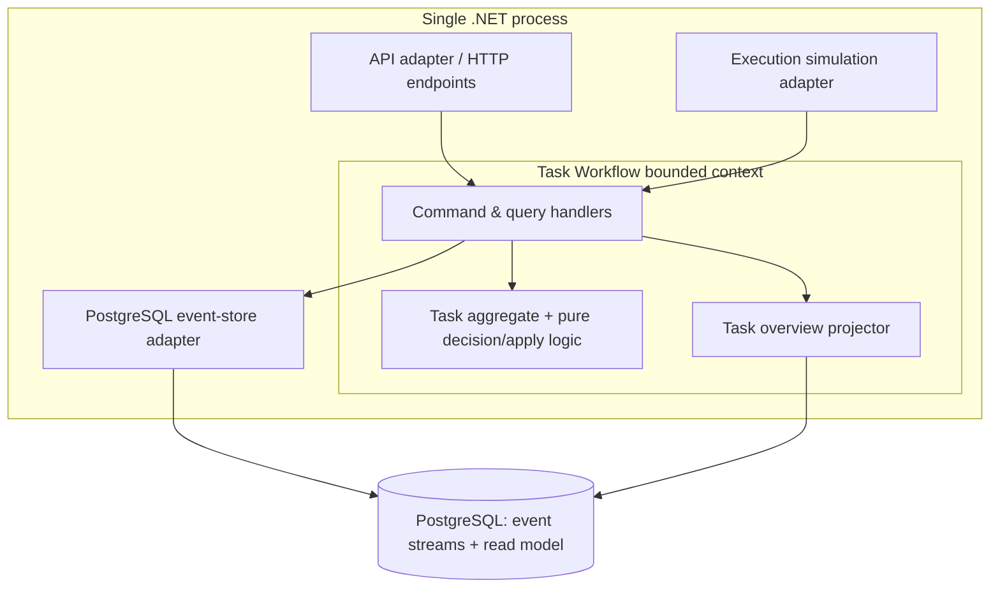
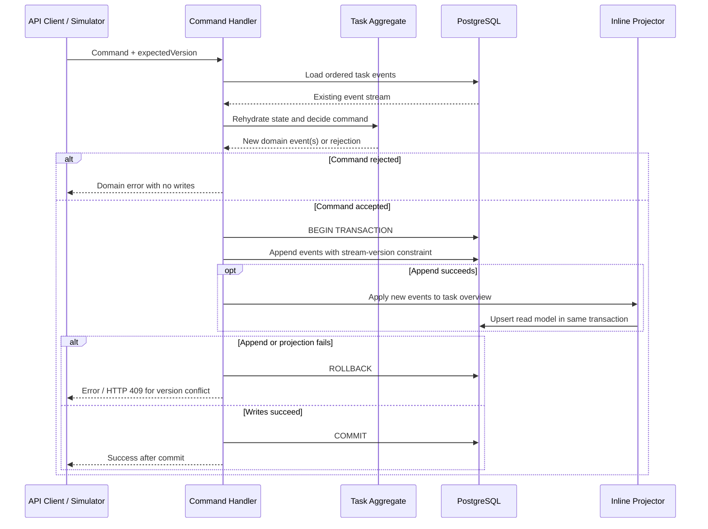

# EventForge — Architecture Proposal

> **Status: Foundation, Event Store, pure Task aggregate, Application command and query handling, composition-root wiring and the local Task REST API (EVF-24) implemented; transactional projections, replay and upcasting planned**
>
> The engineering foundation is implemented and verified: a minimal ASP.NET Core host with a `/health` liveness endpoint (EVF-14), module/adapter project scaffolding (EVF-15; since extended with the Event Store and Domain contracts, with Simulation still empty), static architecture dependency tests (EVF-16), a validated built-in DI composition root with no module services registered (EVF-17), and a baseline GitHub Actions CI workflow (EVF-5) that has run successfully on a pull request and on `main` and whose failure handling and recovery were verified. Also implemented since (Task 6: the transactional `task_overview` projection and migration 002 (EVF-36), the atomic, fail-closed inline projector (EVF-37) and projection-backed `GET /api/tasks/{id}` reads (EVF-38), implemented, locally verified and committed locally; the consolidated EVF-25 pull request has not yet passed GitHub CI; replay, recovery and upcasting remain planned): the PostgreSQL Event Store with integration tests and a CI job (EVF-22) and the Task domain contracts (EVF-28) and the pure `Decide`/`Apply`/`Rehydrate` aggregate logic (EVF-29), the Application command handler that persists its events through the Event Store (EVF-30), and the Task REST API with Swagger UI (EVF-32 to EVF-35; merged in PR #21 with successful GitHub CI; since EVF-38 the state query reads the projection and the history query reads the Event Store). Everything else in this document (replay, recovery, upcasting and security controls beyond the local demo boundary) is a proposal that does not describe a running system. Decisions are deliberately scoped to a small, auditable proof of concept.

## 1. Goals, scope, and constraints

EventForge models a task lifecycle in an AI-assisted software factory. The objective is to demonstrate **correct, deterministic workflow state transitions** and **recoverable projections** when actions are performed by a simulated agent.

**Architecture goals**

1. Preserve an immutable record of task lifecycle decisions.
2. Enforce domain invariants at the write boundary.
3. Make an immediately readable task overview available after successful writes.
4. Reproduce aggregate state and query projections from historical events.
5. Detect conflicting writes and make failures explicit.
6. Keep the initial deployment and developer environment simple.

**MVP constraints**

- One deployable ASP.NET Core process and one PostgreSQL database.
- A single main bounded context: **Task Workflow**.
- Simulated agent/test behavior; no model API calls or external code execution.
- No broker, orchestration cluster, cross-service transactions, or generic workflow engine.
- Replay in a controlled environment where normal writes are paused. Online rebuilds are a later design problem.

## 2. Modular Monolith and ownership boundaries



Arrows show conceptual execution flow, not source-code dependencies. The bounded context includes application orchestration and projection ownership; SQL access remains in infrastructure adapters. The aggregate is pure, and handlers access persistence through application contracts implemented by infrastructure.

### Ownership rules

| Logical component | Owns | Must not do |
| --- | --- | --- |
| **Task Workflow** | Commands, event contracts, aggregate invariants, workflow read-model shape | Call an LLM, run generated code, or depend on HTTP/SQL details inside the domain |
| **Execution Simulation** | Synthetic agent actions and predefined test outcomes | Write directly to the event store or bypass workflow commands |
| **Persistence infrastructure** | Database transactions, event serialization, concurrency enforcement | Decide domain transitions |
| **API adapter** | Request/response contracts, status codes, routing | Duplicate aggregate rules or update read-model tables directly |

`Task Workflow` is the bounded context; `Execution Simulation` is intentionally an adapter, **not** an artificially independent bounded context. Read models remain owned by the Workflow domain while their storage implementation stays in infrastructure. Modules will communicate through explicit application contracts rather than through one another's tables or implementation types.

### Code organization (src scaffolding and architecture tests exist)

```text
src/
  EventForge.Api/              # HTTP composition root and REST endpoints (implemented: /health only)
  EventForge.Workflow/         # Task Workflow bounded context
    Domain/                    #   EventForge.Workflow.Domain: contracts implemented (EVF-28: identifiers, state, commands, events, result types) and pure aggregate `Decide`/`Apply`/`Rehydrate` (EVF-29) implemented
    Application/               #   EventForge.Workflow.Application: handlers, ports, read-model contracts
  EventForge.Infrastructure/   # PostgreSQL connectivity and Event Store adapter (implemented, EVF-21/EVF-22); future transaction and projection adapters
  EventForge.Simulation/       # Future simulated agent/test-outcome adapters (scaffolding only)

tests/
  EventForge.UnitTests/        # Implemented: xUnit architecture dependency tests and Domain contract and aggregate tests (EVF-28, EVF-29)
  EventForge.IntegrationTests/ # Implemented (EVF-22): PostgreSQL Event Store tests (PostgreSql category)
```

Domain and Application share one assembly (`EventForge.Workflow`) for this baseline and are separated by folder and namespace. Further assemblies should be introduced only where they preserve meaningful dependency direction.

**Direct project references (implemented):**

| Project | Direct project references |
| --- | --- |
| EventForge.Api | EventForge.Workflow, EventForge.Infrastructure, EventForge.Simulation |
| EventForge.Workflow | None |
| EventForge.Infrastructure | EventForge.Workflow |
| EventForge.Simulation | EventForge.Workflow |

Workflow references no outer project; Infrastructure and Simulation do not reference each other or the API; the API is the only executable composition root. Application code may depend on Domain code; Domain code must not depend on Application code. Infrastructure implements future persistence and transaction adapters, and Simulation implements future synthetic agent and test-outcome adapters; neither decides domain transitions.

**Enforcement status:** When EVF-16 was delivered the projects were empty scaffolding; Workflow now contains the EVF-22 Event Store contracts and the EVF-28 Domain contracts, and Simulation remains empty. `tests/EventForge.UnitTests` (EVF-16) checks the project-reference matrix above from the actual `.csproj` files and, using Roslyn semantic analysis, the namespace rules for Domain, Application, Infrastructure and Simulation (including Domain independence from HTTP and SQL libraries). Hand-written Workflow source outside the Domain and Application folders is rejected, namespaces are validated from resolved symbols, and API files may not declare namespaces owned by other modules. Synthetic positive and negative fixtures run through the same checker. All sources are analyzed in one combined Roslyn compilation against the .NET framework assemblies plus the single explicitly approved Npgsql metadata assembly (EVF-21), so types from any other package resolve as errors (reported, not ignored). Domain now contains the EVF-28 contract types and the EVF-29 pure aggregate logic, and Application the EVF-22 Event Store contracts, so the production scan covers those sources; the fixtures demonstrate that the checker rejects forbidden dependencies. The analysis is static: it does not evaluate MSBuild conditions or imports, check `PackageReference` items, or detect reflection or runtime behavior. The checker enforces dependency boundaries; it does not prohibit every nondeterministic framework API (for example `DateTime.UtcNow`, `Guid.NewGuid`, `Random` or `System.IO`), because those types live in namespaces the Domain may legitimately use. Domain purity is currently supported by code review and focused tests, not by a comprehensive static purity analyzer. The tests run locally and in the baseline CI workflow (EVF-5), which executed them successfully on GitHub Actions (see Section 9). See the README for commands and results.

### C# and .NET implementation guidance (proposed)

Use strongly typed commands, events, and domain results, with records and immutable state where appropriate. Prefer explicit results for expected business rejections and version conflicts; reserve exceptions for unexpected failures and handle them at adapter boundaries. Map domain results to HTTP responses outside the domain.

Use constructor injection and small application-owned interfaces for persistence and simulated outcomes. Keep concrete implementations where an interface adds no useful boundary; avoid generic repository layers, service locators, and mandatory mediator or event-framework dependencies. Keep the domain independent of ASP.NET Core and database libraries. Use asynchronous I/O with propagated `CancellationToken` values at application and adapter boundaries; keep reducers synchronous and pure, and dispose database resources deterministically.

**Adopted (EVF-21, ADR 0001 decision history):** direct parameterized SQL with **Npgsql 10.0.3** and no ORM, confined to `EventForge.Infrastructure` as the only production dependency (the UnitTests project holds a separate, metadata-only reference for the architecture checker; see Section 9). Provenance and licensing were reviewed before adoption: NuGet.org repository-signed package from the official `npgsql/npgsql` repository, PostgreSQL license, only Microsoft transitive dependencies, no known vulnerabilities at the time of review. It makes expected-version enforcement and transaction ownership explicit: event inserts and inline projection writes must use the same connection and transaction, with rollback on failure and success reported after commit. SQL identifiers require trusted mappings rather than value parameters. See [Npgsql basic usage](https://www.npgsql.org/doc/basic-usage.html) for parameter and transaction mechanics.

**Implemented (EVF-21):** `PostgreSqlDatabase` (Infrastructure) owns one `NpgsqlDataSource`, registered as a singleton in the API composition root and disposed by the container. Npgsql types do not appear outside Infrastructure. The Event Store was added by EVF-22 (see Section 4); no aggregate behavior or projection exists yet. The connection string is the standard `ConnectionStrings:EventForge` setting (user secrets or `ConnectionStrings__EventForge`); the host does not require it to start. See the [development guide](development.md) for configuration, the read-only `--verify-database` check, optional Docker support and provisioning.

### Composition root and dependency injection (EVF-17)

**Implemented:** `src/EventForge.Api/Program.cs` is the composition root and uses the built-in ASP.NET Core container (no additional container, scanning or service locator). It sets `ValidateOnBuild = true` and `ValidateScopes = true` through `UseDefaultServiceProvider` in every environment, registers `AddHealthChecks()` and (EVF-21) a lazily created singleton `PostgreSqlDatabase`, and maps `/health`. Since EVF-33/EVF-34 it also registers, as singletons, `IEventStore` (`PostgreSqlEventStore`), `TaskCommandHandler` (event ids from `Guid.NewGuid`) and `TaskQueryHandler`, with Problem Details and strict JSON options, and maps the seven Task routes; the OpenAPI document and Swagger UI are mapped in Development only. The database singleton is still created lazily, so the host starts without credentials.

**Deferred:** Simulation registrations are not implemented. Each further service will be added explicitly in the API composition root when a concrete service exists, not before. No future service should be assumed to be registered or validated.

**Policy (applies once services exist):**

- `EventForge.Api` owns the composition root. Application owns its ports and contracts; adapters implement application-owned ports. The domain stays independent of the DI container.
- Services use constructor injection. Circular dependencies and captive scoped dependencies are forbidden.
- Singletons must be safe for shared concurrent use. Scoped services use a request or unit-of-work lifetime. Transient is used where appropriate. Each lifetime is chosen from an actual implementation, not speculatively.

**Limits of validation:** `ValidateOnBuild` and `ValidateScopes` are a baseline check on the registered graph. They do not guarantee validation of every runtime dependency path, factory delegate implementation or open generic registration. The `/health` endpoint reports process liveness only; it does not prove database readiness, workflow behavior or future service resolution. Because the database singleton is created by a factory, `ValidateOnBuild` does not exercise it; database readiness is checked only by the explicit `--verify-database` command.

## 3. Domain model and event contract

### Task aggregate

The `Task` aggregate is the write-side consistency boundary. It accepts explicit commands and emits events only when its invariants permit a transition.

**Implementation status (EVF-28, EVF-29):** the Domain contracts (EVF-28) and the pure aggregate logic (EVF-29) are implemented in `EventForge.Workflow.Domain`: strongly typed identifiers, `TaskState`, the six commands, the six approved event definitions with `TaskEventContract` (stream type `Task`, schema version 1), `Decision`/`RejectionCode`, and `TaskAggregate.Decide`/`Apply`/`Rehydrate` with unit tests. The rules in this section are enforced by this code in memory: `Decide` returns explicit rejections and no events; `Apply` folds recorded facts without calling `Decide` and throws `InvalidEventHistoryException` (message limited to event type and 1-based position) for malformed events or histories that violate the schema v1 invariants. Verified locally only. **Not implemented:** the REST API, composition-root registration, projections and replay.

**Command workflow (EVF-30):** `TaskCommandHandler` (`EventForge.Workflow.Application.Tasks`) first validates the command's members (`TaskAggregate.ValidateCommand`, before any I/O), then loads the `Task` stream, returns `VersionConflict` if the caller's expected version differs from the loaded version (before deciding), rebuilds the aggregate from the stored events, calls `Decide`, and appends the resulting events in a single `IEventStore.AppendAsync` call, which is one PostgreSQL transaction (EVF-22). Results are explicit: `CommandSucceeded`, `CommandRejected` (nothing appended), `VersionConflict` (including a lost race, current version unknown), `DuplicateEventId`, `InvalidHistory` (reason and 1-based position only) and `CommitUnknown`. Nothing is retried, and this is not durable request idempotency. Event ids and metadata (optional `correlationId`) are supplied outside the pure aggregate. `TaskEventMapper` maps events explicitly for schema version 1; payloads are JSON objects with camelCase properties, written in a fixed order: `TaskCreated {taskId}` (canonical lowercase GUID, must equal the stream id), `TaskAssigned {agentId}`, `CodeGenerated {generationId, artifactRef}`, `TestsPassed {generationId}`, `TestsFailed {generationId}`, `TaskCompleted {}`. Reading is strict and fail-closed: every stored event must belong to the requested stream (stream type and stream id), and `TaskCreated.taskId` must equal it; unknown event types, other schema versions, non-object payloads, case-mismatched, missing, extra, null or non-string properties, duplicate properties and a non-canonical task id are rejected; an additive change needs a new schema version (upcasting is not implemented). Duplicate JSON keys can be detected only while a payload still contains them: PostgreSQL JSONB keeps the last duplicate key, so they are not detectable after storage. Verified locally with unit tests (in-memory test double) and PostgreSQL integration tests against a disposable PostgreSQL 17; CI for EVF-30 has not run.

| Command | Proposed event | Rule |
| --- | --- | --- |
| `CreateTask` | `TaskCreated` | A task identifier must not already exist. |
| `AssignTask` | `TaskAssigned` | Task exists and is not yet assigned or completed. |
| `RecordCodeGenerated` | `CodeGenerated` | Task exists, is assigned, and is not completed; `generationId` must be new within this task. |
| `RecordTestsPassed` | `TestsPassed` | Task exists and is not completed; outcome identifies the **current**, previously recorded generation. |
| `RecordTestsFailed` | `TestsFailed` | Task exists and is not completed; outcome identifies the **current**, previously recorded generation. |
| `CompleteTask` | `TaskCompleted` | Task exists, is assigned, and is not completed; the latest test outcome for its current generation is passed. |

Completion is terminal: after `TaskCompleted`, reject every workflow command, including repeated completion, assignment, generation, and test-result commands. Queries remain available. Assignment requires an existing, unassigned, incomplete task; generation requires that assignment first. No reassignment or reopening command is defined.

Generation identifiers are opaque and unique within a task, including superseded generations. Reusing an identifier is invalid even if the artifact reference differs. The aggregate reconstructs the set of used identifiers from history. Reject test results before any generation exists, for unknown identifiers, or for a superseded generation.

A later `CodeGenerated` event makes its generation current and resets the current test outcome to absent; earlier outcomes remain immutable history. Therefore, `TestsPassed(g1)` followed by `CodeGenerated(g2)` cannot authorize completion until `TestsPassed(g2)` is recorded. Completion requires the latest outcome to be passed, not merely a pass somewhere in history.

Commands that violate a domain rule return a validation/conflict result and append **no events**. The same semantic decision should be testable without PostgreSQL or HTTP.

Repeated test results for the current generation are permitted; the latest outcome determines completion eligibility. Restricting repeated results or adding reassignment/reopening would change domain policy and requires explicit project-owner approval and an authorized ADR before adoption.

### Illustrative event envelope

This is a **planned contract example**, not a sample extracted from any real system or an existing table:

```json
{
  "eventId": "e8643c80-7949-4f15-99ec-0d31c28d21c5",
  "streamId": "9d56311e-acda-47c9-8a1c-f8e5d5605f4c",
  "streamType": "Task",
  "streamVersion": 3,
  "eventType": "CodeGenerated",
  "schemaVersion": 1,
  "payload": {
    "generationId": "g2",
    "artifactRef": "synthetic://artifacts/task-123/g2"
  },
  "metadata": {
    "correlationId": "demo-run-001",
    "actorType": "SimulatedAgent"
  },
  "recordedAt": "2026-11-16T12:00:00Z"
}
```

The stable `eventType` and numeric `schemaVersion` identify a logical event contract. `recordedAt` is a persisted fact, **not** something recomputed during replay. Event payloads contain synthetic references, not embedded source trees or secrets.

## 4. Event Store design (PostgreSQL)

### Proposed minimal storage schema

| Column | Intent |
| --- | --- |
| `event_id UUID` | Unique immutable identity for each event. |
| `stream_type TEXT` | Aggregate type, initially `Task`. |
| `stream_id UUID` | Task aggregate identifier. |
| `stream_version INTEGER` | Contiguous position within the aggregate stream, starting at 1. |
| `event_type TEXT` | Stable event name. |
| `schema_version INTEGER` | Serialization contract version. |
| `payload JSONB` | Versioned event body. |
| `metadata JSONB` | Causation/correlation information and actor type. |
| `recorded_at TIMESTAMPTZ` | Server-assigned or explicitly persisted recording time. |

**Required constraints:** primary key on `event_id`; unique constraint on `(stream_type, stream_id, stream_version)`, whose underlying index also serves ordered loading of one stream (no separate index is added unless measurements show a need). A JSONB payload is flexible but does **not** replace explicit contract validation and versioned deserialization.

### EVF-22 implementation notes (implemented; verified against an isolated PostgreSQL 17 in CI, [PR #16](https://github.com/FarazLoloei/eventforge-event-sourcing-demo/pull/16))

This describes the implemented Event Store only. The Event Store was delivered without Task domain events or an aggregate; the Task events and pure aggregate have since been added in the Domain (EVF-28, EVF-29, see Section 3) and their serialization and Event Store integration through the command handler were added by EVF-30 (see Section 3). The API workflow, inline projections, replay/recovery and upcasting also remain unimplemented (Tasks 4-8).


The Application layer owns `IEventStore` (`LoadStreamAsync`, `AppendAsync`) and the contracts `StreamKey`, `NewEvent`, `StoredEvent`, `LoadedStream` and `AppendResult` (`Workflow/Application/EventStore`). `PostgreSqlEventStore` in Infrastructure implements them over `eventforge.events`, created by `db/migrations/001-create-event-store.sql`. Constraint names: `events_pkey`, `events_stream_version_uq`; `CHECK`s require positive versions, stream/event names matching `^[A-Za-z][A-Za-z0-9._-]{0,99}$` and JSON-object payload and metadata. `recorded_at` is the PostgreSQL transaction timestamp, returned in the persisted envelope (one value per append batch).

- **Append** runs in one `READ COMMITTED` transaction: read `count(*)` and `max(stream_version)` for the stream; `count <> max` means a gap, so it throws `EventStreamCorruptedException` instead of extending the stream; `max <> expectedVersion` returns `VersionConflict` with the observed version; otherwise insert the batch and commit. Success is reported only after commit.
- **Racing writers** that both pass the check are separated by the unique constraint: the loser's violation of `events_stream_version_uq` becomes `VersionConflict` with `CurrentVersion = null` (the winner's version is deliberately not re-read; reload to learn it). A violation of `events_pkey` becomes `DuplicateEventId`; the whole batch is rolled back. No advisory locks, no retries.
- **Unknown commit:** a connection failure or cancellation while committing throws `EventStoreCommitUnknownException`; the caller must reload the stream. Failures before commit are definite rollbacks.
- **Load** validates that versions are exactly `1..n`. Upcasting is not implemented (Task 8). JSONB normalises key order and whitespace, so a loaded payload is structurally, not textually, equal to the submitted one.
- The append logic is a separate internal method taking a connection and transaction so that a later task can run it in a transaction shared with an inline projector; since EVF-37 `PostgreSqlEventStore` runs the Task projector on that same connection and transaction, before the single commit (Section 5).

### Expected-version semantics

- `LoadStream(taskId)` returns events in ascending `stream_version`.
- A command declares `expectedVersion` (0 for a new stream).
- If the current stream version differs, the append is rejected. The API maps this to **HTTP 409 Conflict** (`version_conflict`, EVF-33); an unknown `currentVersion` is omitted rather than guessed.
- A unique database constraint on the stream/version tuple is the final write-race safeguard, even if two writers observed the same old version.
- For a multi-event command, all appended versions and projection changes succeed or fail **as one PostgreSQL transaction**.

Append assigns contiguous versions starting at expectedVersion + 1. Stale commands are rejected without automatic retries: callers must reload and reassess intent. Stream concurrency does not provide durable request deduplication.

Optimistic concurrency answers whether the stream has changed since the caller's expected version. Durable request idempotency would recognize the same request across retries and return its recorded result without executing it again. A retry after a lost response may encounter a version conflict or domain rejection; neither establishes the original request's outcome. Generation-ID uniqueness is a domain invariant, not request deduplication. Durable request idempotency remains deferred.

The initial design relies on **optimistic concurrency and unique constraints**, not mandatory advisory locks. Advisory transaction locks are a possible later optimization if contention or ordering requires them; they are not needed to make the initial single-stream append safe.

If measured hot-stream contention or an approved coordination requirement justifies advisory locks, prefer transaction-scoped locks that release at commit/rollback. All participating writers must use the same stable lock-key mapping and acquisition order, with bounded waits and deadlock handling. Acquire before the protected read/decision within that transaction; a lock acquired after deciding cannot make stale state current. Advisory locks are cooperative: retain expected-version checks, uniqueness constraints, and atomic event/projection writes. Do not silently retry domain decisions or treat locks as request idempotency. Adoption requires owner review; session-scoped locks are unsuitable as a default for pooled connections. See [PostgreSQL advisory locks](https://www.postgresql.org/docs/current/explicit-locking.html#ADVISORY-LOCKS).

## 5. CQRS flows

### Write path: commit the event and read model together



Domain logic is conceptually `Decide(state, command) -> events | error` and `Apply(state, event) -> state`. Both are pure and deterministic for fixed inputs. Decide validates current intent; Apply folds historical facts without re-running command validation against current rules. Neither reads ambient state or performs I/O. Values that would otherwise be nondeterministic (clock reads, random IDs, external test results) are supplied at the command boundary and recorded in events.

**Atomicity invariant:** in the MVP, a successful event append and its corresponding task overview update are part of the same local transaction. A projection failure aborts the event append. This provides immediately consistent **local** reads without a message broker. It does not imply distributed transaction guarantees.

### Read path

**Implemented (Task 5, EVF-34; the state half has since been replaced by EVF-38, below):** `GET /api/tasks/{id}` and `GET /api/tasks/{id}/events` are served by `TaskQueryHandler`, which loads the committed stream, validates it with the shared `TaskHistory` fold (the same strict mapper and `TaskAggregate.Apply` used by the command handler) and returns the state or the safe, ordered event history; an invalid history fails explicitly with no partial result. The whole stream is read on every request, an intentional small-demo trade-off. See [api-contracts.md](api-contracts.md).

**Implemented (Task 6, EVF-37 and EVF-38; committed locally, not run in GitHub CI):** every append to a `Task` stream also updates `task_overview` inside the same PostgreSQL transaction (fail-closed: no configuration appends Task events without the projector), and `GET /api/tasks/{id}` reads the committed projection row through an Application port instead of folding the stream; the route and response contract are unchanged, and the history endpoint keeps reading and strictly validating the Event Store. A Task stream that has events but no projection row is a safe `500`, never a `404`; nothing is backfilled or replayed, and deploying against a database that already holds Task events needs a separately approved cutover (not implemented). The projection row checks are plausibility checks, not proof of equivalence with the history; replay and diff verification (Task 7) is not implemented.

The `task_overview` row (migration 002) contains `task_id`, `status`, `assigned_agent_id`, `current_generation_id`, `latest_test_result`, and `last_stream_version`. The projector is a deterministic reducer. A version guard requires the next contiguous stream version and rejects duplicates or gaps, rolling back the transaction. Rebuilds start each stream at version zero. Task-local projections require no ordering across streams. Success is returned only after commit; immediately consistent reads assume the primary database, not a lagging replica.

## 6. Replay, rebuilding, and schema evolution

### MVP: controlled offline projection rebuild

1. Pause all command writers and drain in-flight transactions. Keep writes paused through validation and cutover.
2. Create an empty shadow projection. Record the projector/upcaster versions and authoritative stream inventory with terminal stream versions.
3. Upcast supported contracts and replay each stream in contiguous stream-version order. Reject gaps, unknown contracts, malformed events, or reducer failures.
4. Validate the candidate against history: one row per task stream, no extra rows, matching terminal versions, and expected status, assignment, generation, and test outcome derived from recorded facts. Independent reference folds and known-history fixtures must test these expectations; repeating the same projector alone cannot detect its own logic defects.
5. Produce a deterministic diff and apply the scenario criteria below. Cut over only after candidate validation succeeds, using an atomic table/view switch and retaining the previous table for rollback.
6. Check that command-side projection updates and queries target the replacement before resuming writes. On failure, leave the candidate inactive and report diagnostics. A damaged baseline remains unavailable for trusted queries until recovery succeeds.

**Verification:** For a healthy projection, compare the candidate against the baseline at the same source boundary and projection contract. Require zero semantic differences and successful history validation. This demonstrates equivalence for the tested history.

**Recovery:** For a damaged projection, report discrepancies against the baseline, then validate the replacement against authoritative history and reference expectations before cutover. Equality with the corrupted projection is not a recovery condition. If history itself is damaged or unsupported, stop: rebuilding a projection cannot repair the source of truth.

### Deterministic projection diffing

Compare the complete key set sorted by task_id and these fields: status, assigned_agent_id, current_generation_id, latest_test_result, and last_stream_version. Use canonical UUID/text representations, ordinal comparisons, explicit nulls, and stable field/report ordering. Exclude only operational metadata such as rebuild timestamps, never business fields. Report missing/extra rows and per-field before/after values; counts or hashes alone are insufficient. Repeating the diff on identical inputs must produce identical output. Projection contract changes require an explicit comparison mapping before equivalence checks.

**Replay never triggers real-world effects.** Historical events update state and projections only; replay never calls agents, regenerates artifacts, reruns tests, sends notifications, or dispatches external work. A dedicated replay path excludes side-effect handlers and is tested using adapters that fail if invoked. Maintenance operations such as cutover are outside event application.

### Future: replay under active load

An online rebuild would need shadow projections, a **commit-safe** method to capture and catch up with live events, validation before a short cutover, and a rollback strategy. A PostgreSQL sequence/identity value is **not necessarily transaction commit order**: naive “process every event with ID greater than watermark” logic can miss a late-committing transaction. The MVP deliberately avoids claiming to solve this problem.

### Event contract changes

> **Status: Proposed / Pending Owner Approval (EVF-40, parent EVF-26).** This is a design proposal, not an adopted contract. Nothing below is implemented: the code still writes and reads schema v1 only, and no upcaster, v2 writer or compatibility test exists. Adoption requires explicit project-owner approval and a dated entry in an authorized ADR; EVF-41 (upcaster) and EVF-42 (integration) may start only after that approval. Historical ADR decisions are unchanged.

Every stored event has `eventType` and `schemaVersion` from the start. In the MVP, explicit **upcasters** transform old serialized contracts to the current in-memory representation on read, without rewriting historical event rows. Upcasters are pure, deterministic transformations chained explicitly by event type and schema version. Unknown versions or missing steps fail closed.

#### Proposed change: `CodeGenerated` v1 to v2 (field rename only)

Schema versions are **per event type**. Only `CodeGenerated` evolves; `TaskCreated`, `TaskAssigned`, `TestsPassed`, `TestsFailed` and `TaskCompleted` stay at v1, and there is no global version bump. Event meaning and Domain behavior do not change: `artifactRef` is renamed `artifactReference`, with the same value and the same invariants.

| | Payload (exactly these two properties, both JSON strings) |
| --- | --- |
| **v1** (historical, immutable) | `{ "generationId": "g2", "artifactRef": "synthetic://artifacts/g2" }` |
| **v2** (proposed current) | `{ "generationId": "g2", "artifactReference": "synthetic://artifacts/g2" }` |

The synthetic values are examples only; the envelope in Section 3 remains a valid historical v1 example.

**Compatibility matrix (proposed)**

| Event type | Readable stored versions | Written for new events (after approval and implementation) | Read behavior |
| --- | --- | --- | --- |
| `TaskCreated`, `TaskAssigned`, `TestsPassed`, `TestsFailed`, `TaskCompleted` | 1 | 1 | Validate v1 and map. Any other version is unsupported. |
| `CodeGenerated` | 1, 2 | 2 | v1: validate source, apply the explicit v1-to-v2 step, validate target, map. v2: validate and map directly. Any other version (0, negative, 3 or higher) is unsupported. |
| Any other `eventType` | none | none | Unknown event type: fail. |

| Reader or writer | v1 `CodeGenerated` | v2 `CodeGenerated` |
| --- | --- | --- |
| Current unmodified reader (today's code) | Reads | **Rejects** (`UnsupportedSchemaVersion`) |
| Proposed reader (EVF-41/42) | Reads through the upcast | Reads directly |
| Proposed writer | Never writes v1 | Writes v2 |
| Rewriting stored v1 rows to v2 | Never | n/a |

**Forward compatibility is not provided.** Old unmodified application readers cannot read a stream containing a newly written v2 `CodeGenerated`: the strict v1-only mapper rejects it, so history queries and commands on that stream fail with `invalid_event_history`. Rolling back to a binary that predates the reader is unsupported once any v2 event exists. This design offers backward compatibility only (a new reader reads old history), not safe downgrade. The v2-capable reader must be deployed before or together with the v2 writer. For this portfolio MVP, shipping both in one release is acceptable, provided the reader handles v1 and v2 before any v2 event is written. Historical v1 events stay immutable, and no event rewriting or downgrade mechanism is introduced.

#### Three representations, kept distinct

| Layer | What it is | Rules |
| --- | --- | --- |
| **Original stored envelope** (`StoredEvent`) | The persisted row: `eventId`, `streamType`, `streamId`, `streamVersion`, `eventType`, `schemaVersion`, `payload` (JSONB), `metadata` (JSONB), `recordedAt`. | Immutable. Read-only input to every conversion. Its `schemaVersion` is the historical fact. |
| **Normalized in-memory representation** | The same envelope fields with the payload converted to the current contract for its event type (for `CodeGenerated`, the v2 shape). Transient, produced per read. | Never persisted, never returned over HTTP. Copies `eventId`, `streamId`, `streamType`, `streamVersion`, `metadata` and `recordedAt` unchanged and keeps the original `schemaVersion` available for diagnostics and history. Only the payload (and the in-memory target version) change. |
| **Domain event** (`CodeGenerated(GenerationId, ArtifactRef)`) | The aggregate's fact, with no schema version, JSON or field names. | Unchanged by this design, including the `ArtifactRef` property. `Apply` receives the same Domain event whether the source was v1 or v2. |

The pipeline is: stored envelope, validate source, upcast (v1 only), validate target, map to Domain event, `Apply`. Because the Domain event is identical, aggregate behavior cannot depend on how an event was stored.

#### Upcast and validation rules

The v1-to-v2 step is a pure function: it copies `generationId` unchanged and sets `artifactReference := v1.artifactRef` exactly. It performs no I/O, clock reads, randomness or artifact lookup, does not mutate its input, never appends a replacement event, and yields identical output for identical input. It must not generate a missing generation ID, infer an artifact, or add an unrecorded timestamp, agent or test outcome. A future change that needs a fact absent from old history needs its own approved design.

Validation is strict at both ends and fails closed with no partial result. Reuse the existing `InvalidHistoryReason` values; no new reason or HTTP error code is proposed.

| Condition | Result (existing reason) |
| --- | --- |
| Unknown `eventType` | `UnknownEventType` |
| `schemaVersion` not supported for that type (0, negative, 3+, or 2 for any type other than `CodeGenerated`), or no upcast step to the current version | `UnsupportedSchemaVersion` |
| Payload not a JSON object | `MalformedPayload` |
| Missing required property (v1: `artifactRef`; v2: `artifactReference`) | `MalformedPayload` |
| Extra property, including a v2 payload that still has `artifactRef`, a v1 payload that already has `artifactReference`, or both names | `MalformedPayload` |
| Property not a JSON string (null, number, object, array, boolean), or wrong-case name | `MalformedPayload` |
| Blank, overlong or control-character `generationId` / artifact value (Domain value-type rules) | `MalformedPayload` |
| Upcast output that does not satisfy the v2 shape | `MalformedPayload` (indicates a defect in the step) |
| Wrong stream type or stream id, non-contiguous versions | `InvalidSequence` / `StreamCorrupted` (unchanged) |

Diagnostics carry only the reason and 1-based position, as today; event ids and versions may appear in restricted operator logs, never in HTTP bodies. Load, command handling and replay stop at the first fault, and a replay candidate stays inactive. The reader applies the Domain value-type rules but not the API-only `synthetic://` pattern, so historical events stay readable. Duplicate JSON keys are not detectable after JSONB storage (Section 3).

Per-event-type versions mean the single global `TaskEventContract.CurrentSchemaVersion` (a documented discrepancy below) must be replaced by an explicit per-type mapping. A generalized upcaster registry, framework or plug-in mechanism is **not** proposed: one explicit step for one event type is enough for this demonstration.

#### Public HTTP compatibility

- Command requests keep `artifactRef` (`POST /api/tasks/{id}/generations`); this design adds no request field, route or status code.
- `GET /api/tasks/{id}/events` keeps `data.artifactRef` for every `CodeGenerated`, whether stored as v1 or v2. `data` continues to be built from the mapped Domain event, never from the raw payload.
- The history `schemaVersion` reports the **original stored envelope's** schema version (1 or 2). It describes how the event was stored, not the field naming of the sanitized `data`, so a v2 event appears as `schemaVersion: 2` with `data.artifactRef`. Clients must not infer `data` field names from `schemaVersion`. The code already passes `StoredEvent.SchemaVersion` through; EVF-42 must keep it so.
- `GET /api/tasks/{id}` is unchanged. `task_overview` has no artifact column, so no migration, projection contract change or rebuild is needed; however, the inline projector maps appended events through the strict v1 mapper today and must use the same normalization reader once new events are written as v2 (EVF-42).

#### Persistence and JSONB

No database migration is proposed: `schema_version` and `payload` already exist, and v2 needs no new column or constraint. PostgreSQL stores `payload` and `metadata` as JSONB, which normalizes key order and whitespace and keeps only the last of duplicate keys, so **byte-for-byte preservation of JSON text is neither provided nor claimed**. Immutability of historical rows is verified by comparing, before and after an upcasting read or replay-style pass, the envelope fields (`event_id`, `stream_type`, `stream_id`, `stream_version`, `event_type`, `schema_version`, `recorded_at`) exactly and `payload` and `metadata` by semantic JSONB equality. Upcasting is read-only (`SELECT`); the planned runtime role has no `UPDATE` or `DELETE` on events (Section 7).

#### Fixture and test plan (acceptance requirements; not implemented)

Use one synthetic lifecycle with independently hand-authored expected values (not computed by the code under test): `TaskCreated`, `TaskAssigned`, `CodeGenerated g1`, `TestsFailed g1`, `CodeGenerated g2`, `TestsPassed g2`, `TaskCompleted` (final stream version 7). Build three histories identical except for the `CodeGenerated` encoding, preserving event ids, stream positions, metadata and `recordedAt`:

1. **v1-only:** both `CodeGenerated` events stored as v1.
2. **v2-only:** both stored as v2.
3. **Mixed v1/v2:** `g1` as v1 and `g2` as v2, plus the reverse order (positionally valid; no monotonic-version rule is enforced or claimed).

For each history, assert at these boundaries: after event 3, event 4, event 5, event 6 and event 7. The expected aggregate state at each boundary is the following independent test data, authored by hand and not computed by the production implementation:

| Stream version | Current generation | Used generations | Latest test outcome | Workflow status |
|---|---|---|---|---|
| 3 | g1 | {g1} | null | Assigned |
| 4 | g1 | {g1} | Failed | Assigned |
| 5 | g2 | {g1, g2} | null | Assigned |
| 6 | g2 | {g1, g2} | Passed | Assigned |
| 7 | g2 | {g1, g2} | Passed | Completed |

Assertions:

- **Each `CodeGenerated.ArtifactRef`** equals the expected synthetic value for `g1` and `g2` (for example `synthetic://artifacts/g1` and `synthetic://artifacts/g2`), identical across all three histories.
- **Complete aggregate state:** status, assigned agent, current generation, set of used generation ids (`g1`, `g2`), current test outcome (cleared after `g2` is generated, `failed` or `passed` as applicable, so completion is blocked until `g2` passes), and version. Final state is completed, current generation `g2`, outcome `passed`, version 7.
- **All six `task_overview` fields:** `task_id`, `status`, `assigned_agent_id`, `current_generation_id`, `latest_test_result`, `last_stream_version`, with business-field diffs reported per field and not by counts or hashes.
- **Final stream versions** of the stream and the projection (7).
- Over HTTP, history `data.artifactRef` is the same for all three and `schemaVersion` is 1 or 2 per stored event.

Further required cases: deterministic repeated conversion; the source envelope and payload not mutated; zero rows rewritten (envelope fields exact, JSONB semantic equality); a new `CodeGenerated` is written as v2 while the other five types remain v1; a rejected command appends nothing; every failure row of the validation table (unsupported versions including 2 for a non-`CodeGenerated` type, unknown type, missing and extra fields, wrong types, blank or overlong values, missing upcast step) fails explicitly with no partial state or history. Existing tests that use schema version 2 as the "unsupported" example for `CodeGenerated` will need review when the contract is adopted; this has not been audited. The old-reader limitation is documented rather than tested, because the repository has no old binary to run. Unit-level fixtures run without PostgreSQL; the projection, row-immutability and HTTP cases need PostgreSQL integration tests.

#### Discrepancies found in the current code (EVF-40 review)

- `TaskEventContract.CurrentSchemaVersion = 1` is one global constant used by the writer (`TaskEventMapper.ToNewEvent`) and the reader (`FromStored`); per-event-type versions need a different shape.
- `TaskEventMapper.FromStored` is the only reader and rejects every version other than 1; `TaskHistory.Fold` (commands, history) and `PostgreSqlTaskOverviewProjector` (appended events) both call it, so both must move to the normalizing reader together.
- Doc comments in `TaskEvents.cs` call the Domain records "the in-memory canonical payload for schema version 1"; under this design they stay accurate for fields but not the version wording.
- The history endpoint already returns the stored `schemaVersion`, so the HTTP requirement above needs no change to its mapping.

#### Decisions requiring project-owner approval

1. Adopt the v1-to-v2 `CodeGenerated` rename and the per-event-type versioning rule, recorded in an authorized ADR with a dated history entry.
2. Accept that old readers cannot read v2 events, with no downgrade path.
3. Confirm that new `CodeGenerated` events are written as v2 only when the v1/v2-capable reader is deployed before or together with the writer (EVF-41/42).
4. Confirm that history `schemaVersion` reports the stored version while `data` keeps `artifactRef`, and that no new `InvalidHistoryReason` or error code is added.
5. Confirm that no migration, projection rebuild or registry is introduced.

### Snapshots

Snapshots are a **planned optimization** for aggregate hydration: `(stream_id, last_applied_stream_version, serialized_state, snapshot_schema_version)`. They must never become the source of truth, and a bad or old snapshot must be bypassable by replaying events. Snapshot implementation is deferred until correctness is demonstrated without it.

## 7. Reliability and failure behavior

| Failure case | Intended behavior |
| --- | --- |
| Invalid state transition | Return a domain error; write nothing. |
| Concurrent appends to same stream/version | Unique constraint rejects the loser; whole transaction rolls back; return conflict. |
| Projection write fails | Roll back event append and projection changes together. |
| API crashes before commit | No partial committed command. |
| API crashes after commit but before response | Caller may be uncertain; later request-id idempotency will address safe retries. |
| Old event contract | MVP upcaster reads the supported historical version; incompatible changes must fail explicitly. |
| Replay encounters malformed event | Stop with diagnostic details; do not silently skip or mutate the authoritative log. |

**MVP baseline:** optimistic concurrency and transaction rollback. **Later hardening:** durable idempotency keys, duplicate-request result caching, tested retries, and online rebuild/cutover. The API must not claim effectively-once command behavior before idempotency has been implemented and tested.

### Security boundaries (planned)

- **Database privileges:** Separate runtime credentials from schema-owner/migration and controlled replay/cutover credentials. The runtime role must not own tables, be superuser, have `BYPASSRLS`, create roles/databases, or inherit administrative roles. Grant only required connection/schema access, event `SELECT`/`INSERT`, and projection read/write privileges; deny event `UPDATE`, `DELETE`, `TRUNCATE`, and DDL. Review `PUBLIC` and default grants. Maintenance privileges are explicit and unavailable through normal requests; replay reads history without changing it. Privileges reduce accidental damage but do not enforce aggregate semantics against a compromised writer. See [PostgreSQL privileges](https://www.postgresql.org/docs/current/ddl-priv.html).
- **Validation and authorization:** HTTP adapters validate shape, size, identifier formats, and allowed values; application entry points enforce the caller's permission for each command, query, and event-history inspection before access. Deny access without an explicit applicable policy. The simulator uses the same command boundary and has no privileged bypass. The aggregate independently enforces domain invariants; persistence uses parameterized SQL and validates stored event contracts. Replay/cutover is a separate operator capability, never an ordinary task command. Caller-supplied actor metadata is not proof of identity. Identity mechanism, permissions, and deployment exposure remain owner-reviewed design work before any shared/network deployment; no authentication system is claimed today.
- **Secrets and data:** Supply credentials through protected configuration outside source control (local developer secrets or environment configuration; deployment secret storage chosen when needed). Do not embed them in command lines, examples, events, artifacts, or logs. Keep fixtures and event facts synthetic; artifact references must not contain credentials, personal data, or confidential source. Restrict access to database backups, projection diffs, and diagnostics as well as live data. Review rotation and encrypted transport/storage needs for the actual deployment; no secret-management service or production security guarantee is adopted here.

### Observability and safe diagnostics (planned)

Use structured logs with stable operation/result codes, safe correlation IDs, stream/event identifiers and versions where appropriate, elapsed time, and transaction outcome. Distinguish validation rejection, authorization denial, version conflict, rollback, unsupported history, replay validation, and cutover outcomes. Record committed success only after commit. Bound and sanitize untrusted diagnostic fields; exclude credentials, connection strings, raw request/event payloads, generated source, and SQL parameter values. Public errors expose a safe code and correlation ID; restricted operator diagnostics may include exception details after redaction, never raw database errors in HTTP responses.

Observe command latency, conflict/rollback counts, projection failures, and replay progress/diff totals using in-process instrumentation and local structured output initially. Deterministic business diffs remain separate from operational timestamps and timings. Protect diagnostic access and define retention before deployment. A collector, dashboard service, distributed tracing backend, or broker is not an MVP prerequisite; select additional tooling only for an approved operational need.

### Conditional future isolation and publication

**Row-Level Security (RLS):** PostgreSQL policies can restrict visible rows and permitted writes in addition to table grants; enabled RLS with no applicable policy defaults to deny. Superusers and `BYPASSRLS` roles bypass it, and owners normally do unless forced under RLS. RLS does not protect whole-table operations such as `TRUNCATE`. It could support future tenant isolation, but cannot replace application authorization. Any tenant design must define trusted tenant identity, event/projection ownership, transaction-local context safe under connection pooling, and cross-tenant denial tests covering queries, writes, replay, and maintenance. Multi-tenancy, tenant columns, and RLS policies are **not MVP requirements**; adoption needs a separate owner-approved design. See [PostgreSQL row security](https://www.postgresql.org/docs/current/ddl-rowsecurity.html).

**Transactional Outbox:** Only if reliable external event publication becomes necessary, evaluate storing publication intent in the same transaction as events and inline projections, then relaying committed messages. Duplicate delivery remains possible, so consumer deduplication, ordering, retries, and monitoring need explicit contracts. Replay must not recreate publication intent or dispatch messages. No outbox, relay, broker, or external publication is required for the MVP; a separate owner-approved design must justify them. See the [Transactional Outbox pattern](https://microservices.io/patterns/data/transactional-outbox.html).

## 8. Architectural trade-offs

| Choice | Advantage | Cost / limitation |
| --- | --- | --- |
| Modular Monolith | Easy local reasoning, direct calls, one deployable unit | Must enforce module boundaries deliberately |
| Event Sourcing for task workflow | Complete task history, replay, auditable transitions | More complex schema evolution and debugging than plain CRUD |
| CQRS read projection | Fast task-list queries, explicit read contracts | Additional projector code and rebuild procedure |
| PostgreSQL inline projections | Atomic local write/read consistency; no broker required | Projection work increases command latency; coupled database deployment |
| Optimistic concurrency | Simple and safe stream version enforcement | Conflicts require caller retries or user-visible handling |
| Simulated agent | Reproducible and safe tests | Does not prove live AI integration or sandbox security |
| Offline initial rebuild | Straightforward, demonstrably correct first step | Requires a write pause; not an online migration solution |

Event Sourcing is intentionally applied to a **workflow with meaningful history**, not to every table indiscriminately. If future requirements demand independent scaling, external integrations, or cross-module workflows, those decisions should be justified with measured evidence and separate ADRs.

## 9. MVP quality gates and engineering guardrails

The implementation will introduce unit tests for pure domain rules, PostgreSQL integration tests for transactions/concurrency, replay equivalence tests, and CI validation. MVP architecture tests enforce domain independence from HTTP, persistence, and simulation, plus allowed module dependencies. MVP engineering guardrails require build/test checks, synthetic fixtures, no secrets in events, and human review, including agent-produced changes. Tests and checks land alongside each capability without requiring real-agent integration. Automated agents will not be authorized to bypass domain commands or directly modify the event log.

Initial architecture dependency tests are implemented and run locally and in CI (EVF-16). A baseline GitHub Actions workflow (EVF-5) restores, builds in Release, runs all existing xUnit tests, including the architecture tests, and uploads TRX results; on its own it added no PostgreSQL, event-contract, concurrency or replay gates. EVF-22 later added a second CI job, `postgres-integration`, that runs the `PostgreSql`-category Event Store integration tests against an ephemeral PostgreSQL 17 service (the first job excludes that category); Existing tests, by capability: architecture dependency tests (EVF-16, in CI); Event Store PostgreSQL integration tests (EVF-22, in CI); and, added by EVF-28 to EVF-31, Domain contract and aggregate unit tests, Task command-handler unit tests and Task workflow PostgreSQL integration tests (recovery scenario, rejections that write nothing, optimistic-concurrency races, strict schema v1 reads). The EVF-28 to EVF-31 tests have been run locally against a disposable PostgreSQL 17; **GitHub CI for the consolidated EVF-23 pull request is still pending**, and no CI result is claimed for them. Still absent (future quality gates): event-contract/upcaster compatibility gates, projection tests and gates, and replay/recovery gates.

**Verified baseline CI (November 19, 2026):** both the pull request run and the `main` push run completed successfully on a GitHub-hosted Ubuntu 24.04 runner with SDK 10.0.404: restore and Release build passed with 0 warnings and 0 errors, 33 tests passed (0 failed, 0 skipped), and the TRX artifact was uploaded. Evidence: [pull request run](https://github.com/FarazLoloei/eventforge-event-sourcing-demo/actions/runs/44484566029), [main run](https://github.com/FarazLoloei/eventforge-event-sourcing-demo/actions/runs/44484880631), [merged pull request #11](https://github.com/FarazLoloei/eventforge-event-sourcing-demo/pull/11).

**Controlled failure and recovery (November 19, 2026):** on temporary review [pull request #13](https://github.com/FarazLoloei/eventforge-event-sourcing-demo/pull/13), a [controlled failure run](https://github.com/FarazLoloei/eventforge-event-sourcing-demo/actions/runs/44532239727) built in Release with 0 warnings and 0 errors, ran 33 passing tests and 1 intentionally failing test (0 skipped), exited the test process with code 1, failed the CI job and still uploaded the TRX artifact. A [recovery run](https://github.com/FarazLoloei/eventforge-event-sourcing-demo/actions/runs/44532814416) after the temporary test was removed passed 33 tests (0 failed, 0 skipped) with 0 warnings and 0 errors and uploaded the TRX artifact. PR #13 was closed without merging, with zero changed files, and `main` was unchanged. The EVF-5 baseline CI implementation and verification are complete.

**Pending or not implemented:** required status checks and branch protection (not configured; they require separate project-owner approval and are outside EVF-5 scope), further quality gates (upcaster, projection, replay; the Event Store PostgreSQL integration gate exists, EVF-22, and the Domain contract and aggregate unit tests exist and have passed locally, EVF-28 and EVF-29, with CI verification recorded for the merged EVF-23 and EVF-24 pull requests (#20 and #21) and none yet for the EVF-25 projection work), and CD or deployment. These gates are planned and land with the capabilities they verify. Verification must also cover denied database operations, rejected unauthorized/invalid requests with no appended events, and redacted diagnostics alongside existing domain, concurrency, and replay checks. Human review remains required; the security controls described in this document are proposed and not implemented.

**EVF-21 (PostgreSQL and Docker configuration):** the architecture checker additionally resolves the single approved `Npgsql.dll` (fail-closed if absent or not 10.x). Npgsql is forbidden in Domain, Application and Simulation and permitted only in Infrastructure, with negative fixtures for each; tests also assert that only Infrastructure references the package among production projects and that the checker's version matches. The `Npgsql` `PackageReference` in `tests/EventForge.UnitTests` is metadata-only (it supplies `Npgsql.dll` to the checker, is never used in code and is not a production dependency). PostgreSQL integration tests, role-privilege tests and a CI database gate were added by EVF-22 for the Event Store (see Section 4); not covered are projection, replay and API-level database checks. Provisioning SQL and the Docker/Compose files were exercised once in an isolated local stack (author-reported, not CI; see [development.md](development.md#verification)); the owner's existing PostgreSQL passed an owner-run `--verify-database` check and Visual Studio was owner-reported healthy. Not verified: the VS Code launch, a second provisioning run, and pull-request CI, which has not yet executed for EVF-21.

## 10. Related documents

- [README](../README.md)
- [Implementation roadmap](roadmap.md)
- [Development environment (EVF-21)](development.md)
- [ADR 0001 — Architectural foundation](adr/0001-architecture.md)

Apart from the implemented foundation described in the status banner, the technology choices and constraints in this document are **proposals pending implementation and verification**, not benchmark results or evidence of a deployed system.
